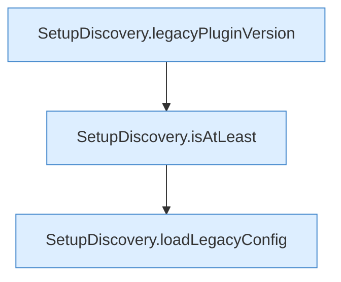

[[00 Start]] › [[Server-Anlage]] › [[Setup-Suche]] › [[SetupDiscovery]] › [[SetupDiscovery.scan]] › [[SetupDiscovery.scan.Teil1]]

# SetupDiscovery.scan.Teil1



```knoten
SetupDiscovery.legacyPluginVersion
  Dieser Teil kümmert sich um das [[Glossar#Plugin|Plugin]] die [[Glossar#Version|Version]]. `legacyPluginVersion` in `SetupDiscovery.java`.
SetupDiscovery.isAtLeast
  Dieser Teil prüft hier einen Schritt. Eine Ebene tiefer steht er genauer. Prüft `isAtLeast`.
SetupDiscovery.loadLegacyConfig
  Dieser Teil lädt den alten Weg die [[Glossar#Einstellungen|Einstellungen]]. Lädt `loadLegacyConfig`.
```

> [!knoten]- Was die Blöcke tun
> - **SetupDiscovery.legacyPluginVersion**: Dieser Teil kümmert sich um das [[Glossar#Plugin|Plugin]] die [[Glossar#Version|Version]]. `legacyPluginVersion` in `SetupDiscovery.java`.
> - **SetupDiscovery.isAtLeast**: Dieser Teil prüft hier einen Schritt. Eine Ebene tiefer steht er genauer. Prüft `isAtLeast`.
> - **SetupDiscovery.loadLegacyConfig**: Dieser Teil lädt den alten Weg die [[Glossar#Einstellungen|Einstellungen]]. Lädt `loadLegacyConfig`.

- Ein weiterer Abschnitt derselben Übersicht.
- Fortsetzung von `SetupDiscovery.scan`.
