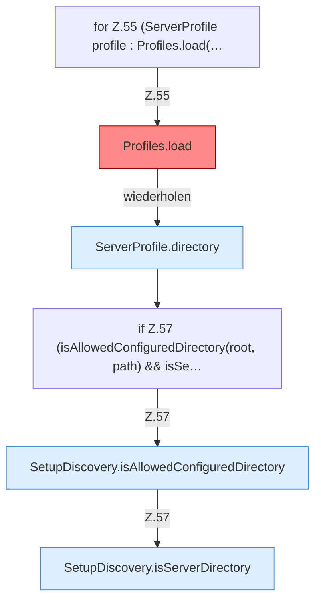

[[00 Start]] › [[Server-Anlage]] › [[Setup-Suche]] › [[SetupDiscovery]] › [[SetupDiscovery.scan]] › [[SetupDiscovery.scan.Teil2.Z54.Z55]]

# SetupDiscovery.scan.Teil2.Z54.Z55



```knoten
for Z.55 (ServerProfile profile : Profiles.load(…
  Zeile 55: Schleife `(ServerProfile profile : Profiles.load(…`.
Profiles.load
  Die Serverbeschreibung lädt das. Lädt `load`. Ruft `one`, `str`, `copyId`. [[Glossar#Befund|Befund]]: angemeldet aber nicht umgesetzt, sicher. ServerProfile.java Profiles.load liest servers.*, reloadProfiles nutzt nur den ersten
ServerProfile.directory
  Die Serverbeschreibung macht hier einen einzelnen Schritt. Eine Ebene tiefer steht er genauer. `directory` in `ServerProfile.java`.
if Z.57 (isAllowedConfiguredDirectory(root, path) && isSe…
  Zeile 57: prüft `(isAllowedConfiguredDirectory(root, path) && isSe…`.
SetupDiscovery.isAllowedConfiguredDirectory
  Dieser Teil prüft die Einstellung. Prüft `isAllowedConfiguredDirectory`.
SetupDiscovery.isServerDirectory
  Dieser Teil prüft den Server. Prüft `isServerDirectory`. Ruft `hasServerFiles`.
```

> [!knoten]- Was die Blöcke tun
> - **for Z.55 (ServerProfile profile : Profiles.load(…**: Zeile 55: Schleife `(ServerProfile profile : Profiles.load(…`.
> - **Profiles.load**: Die Serverbeschreibung lädt das. Lädt `load`. Ruft `one`, `str`, `copyId`. [[Glossar#Befund|Befund]]: angemeldet aber nicht umgesetzt, sicher. ServerProfile.java Profiles.load liest servers.*, reloadProfiles nutzt nur den ersten
> - **ServerProfile.directory**: Die Serverbeschreibung macht hier einen einzelnen Schritt. Eine Ebene tiefer steht er genauer. `directory` in `ServerProfile.java`.
> - **if Z.57 (isAllowedConfiguredDirectory(root, path) && isSe…**: Zeile 57: prüft `(isAllowedConfiguredDirectory(root, path) && isSe…`.
> - **SetupDiscovery.isAllowedConfiguredDirectory**: Dieser Teil prüft die Einstellung. Prüft `isAllowedConfiguredDirectory`.
> - **SetupDiscovery.isServerDirectory**: Dieser Teil prüft den Server. Prüft `isServerDirectory`. Ruft `hasServerFiles`.

- Der Ablauf geht in [[Glossar#Zeile|Zeile]] 55 weiter. Eine Ebene tiefer steht er genauer.
- Fortsetzung von `SetupDiscovery.scan.Teil2.Z54`.
