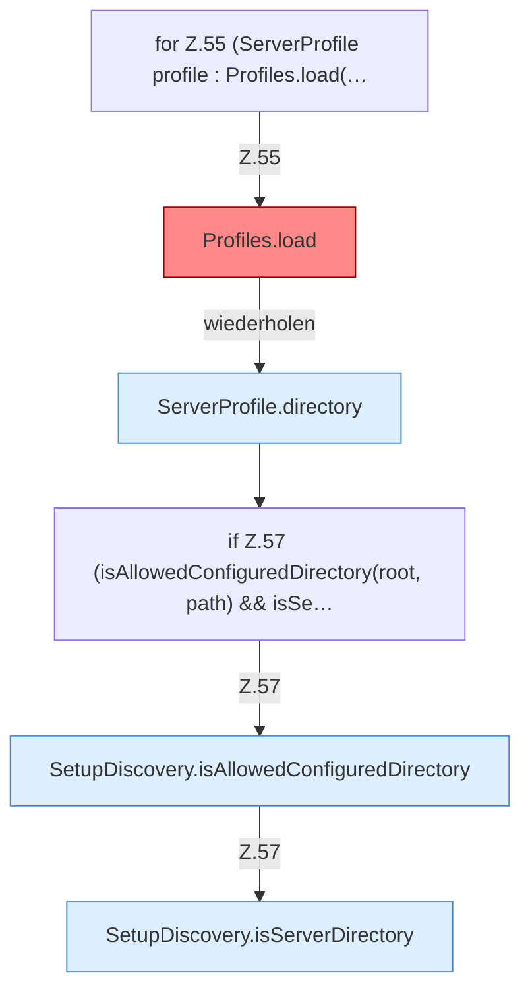

[[00 Start]] › [[Server-Anlage]] › [[Setup-Suche]] › [[SetupDiscovery]] › [[SetupDiscovery.scan]] › [[SetupDiscovery.scan.Teil2.Z54.Z55]]

# SetupDiscovery.scan.Teil2.Z54.Z55



```knoten
for Z.55 (ServerProfile profile : Profiles.load(…
  Zeile 55: Schleife `(ServerProfile profile : Profiles.load(…`.
Profiles.load
  Lädt `load`. Ruft `one`, `str`, `copyId`. Befund: angemeldet aber nicht umgesetzt (sicher).
ServerProfile.directory
  `directory` in `ServerProfile.java`.
if Z.57 (isAllowedConfiguredDirectory(root, path) && isSe…
  Zeile 57: prüft `(isAllowedConfiguredDirectory(root, path) && isSe…`.
SetupDiscovery.isAllowedConfiguredDirectory
  Prüft `isAllowedConfiguredDirectory`.
SetupDiscovery.isServerDirectory
  Prüft `isServerDirectory`. Ruft `hasServerFiles`.
```

- Fortsetzung von `SetupDiscovery.scan.Teil2.Z54`, Quellreihenfolge.
