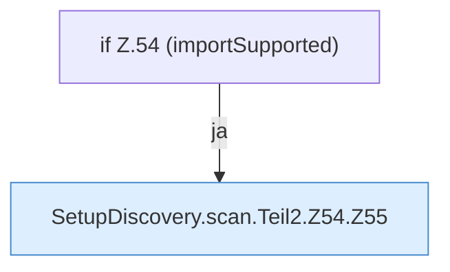

[[00 Start]] › [[Server-Anlage]] › [[Setup-Suche]] › [[SetupDiscovery]] › [[SetupDiscovery.scan]] › [[SetupDiscovery.scan.Teil2.Z54]]

# SetupDiscovery.scan.Teil2.Z54



```knoten
if Z.54 (importSupported)
  Zeile 54: prüft `(importSupported)`.
SetupDiscovery.scan.Teil2.Z54.Z55
  Der Ablauf geht in [[Glossar#Zeile|Zeile]] 55 weiter. Eine Ebene tiefer steht er genauer. Fortsetzung des Ablaufs ab Zeile 55.
```

> [!knoten]- Was die Blöcke tun
> - **if Z.54 (importSupported)**: Zeile 54: prüft `(importSupported)`.
> - **SetupDiscovery.scan.Teil2.Z54.Z55**: Der Ablauf geht in [[Glossar#Zeile|Zeile]] 55 weiter. Eine Ebene tiefer steht er genauer. Fortsetzung des Ablaufs ab Zeile 55.

- Der Ablauf geht in [[Glossar#Zeile|Zeile]] 54 weiter. Eine Ebene tiefer steht er genauer.
- Fortsetzung von `SetupDiscovery.scan.Teil2`.
