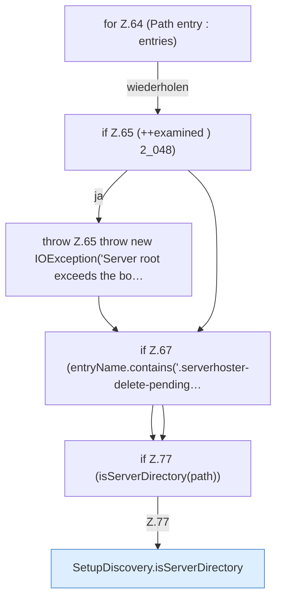

[[00 Start]] › [[Server-Anlage]] › [[Setup-Suche]] › [[SetupDiscovery]] › [[SetupDiscovery.scan]] › [[SetupDiscovery.scan.Teil2.Z62.Z64]]

# SetupDiscovery.scan.Teil2.Z62.Z64



```knoten
for Z.64 (Path entry : entries)
  Zeile 64: Schleife `(Path entry : entries)`.
if Z.65 (++examined ) 2_048)
  Zeile 65: prüft `(++examined ) 2_048)`.
throw Z.65 throw new IOException('Server root exceeds the bo…
  Zeile 65: Abbruch `throw new IOException('Server root exceeds the bo…`.
if Z.67 (entryName.contains('.serverhoster-delete-pending…
  Zeile 67: prüft `(entryName.contains('.serverhoster-delete-pending…`.
if Z.77 (isServerDirectory(path))
  Zeile 77: prüft `(isServerDirectory(path))`.
SetupDiscovery.isServerDirectory
  Prüft `isServerDirectory`. Ruft `hasServerFiles`.
```

- Fortsetzung von `SetupDiscovery.scan.Teil2.Z62`, Quellreihenfolge.
