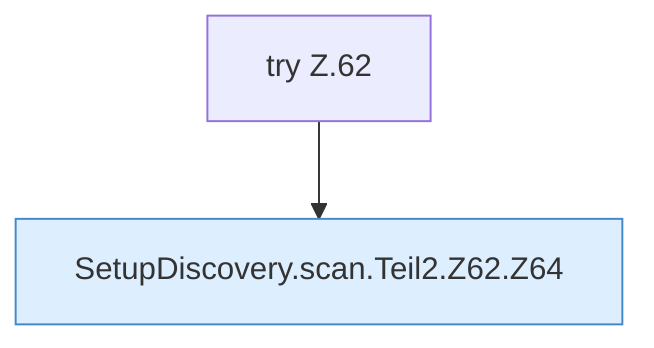

[[00 Start]] › [[Server-Anlage]] › [[Setup-Suche]] › [[SetupDiscovery]] › [[SetupDiscovery.scan]] › [[SetupDiscovery.scan.Teil2.Z62]]

# SetupDiscovery.scan.Teil2.Z62



```knoten
try Z.62
  Zeile 62: Versuch. Der Fehlerpfad geht in catch.
SetupDiscovery.scan.Teil2.Z62.Z64
  Der Ablauf geht in [[Glossar#Zeile|Zeile]] 64 weiter. Eine Ebene tiefer steht er genauer. Fortsetzung des Ablaufs ab Zeile 64.
```

> [!knoten]- Was die Blöcke tun
> - **try Z.62**: Zeile 62: Versuch. Der Fehlerpfad geht in catch.
> - **SetupDiscovery.scan.Teil2.Z62.Z64**: Der Ablauf geht in [[Glossar#Zeile|Zeile]] 64 weiter. Eine Ebene tiefer steht er genauer. Fortsetzung des Ablaufs ab Zeile 64.

- Der Ablauf geht in [[Glossar#Zeile|Zeile]] 62 weiter. Eine Ebene tiefer steht er genauer.
- Fortsetzung von `SetupDiscovery.scan.Teil2`.
