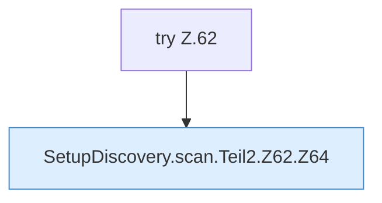

[[00 Start]] › [[Server-Anlage]] › [[Setup-Suche]] › [[SetupDiscovery]] › [[SetupDiscovery.scan]] › [[SetupDiscovery.scan.Teil2.Z62]]

# SetupDiscovery.scan.Teil2.Z62

- Fortsetzung von `SetupDiscovery.scan.Teil2`, Quellreihenfolge.
