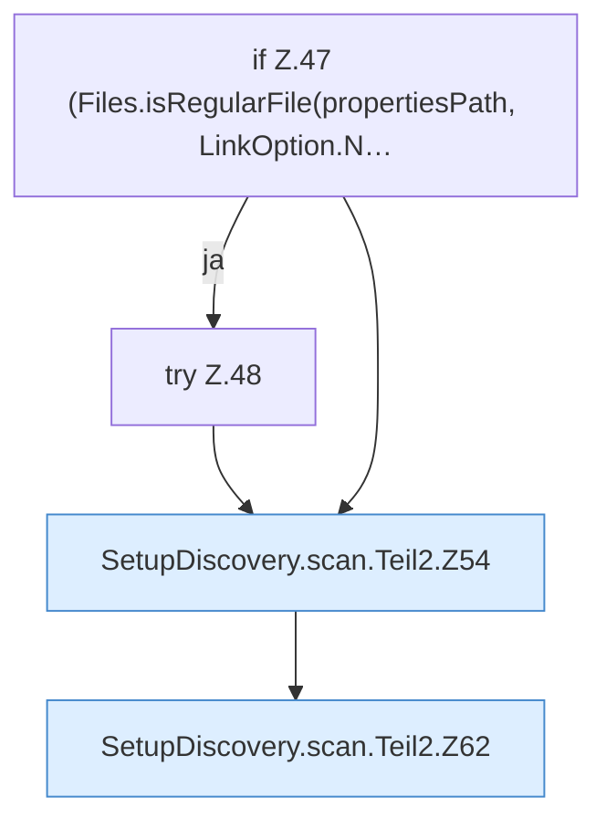

[[00 Start]] › [[Server-Anlage]] › [[Setup-Suche]] › [[SetupDiscovery]] › [[SetupDiscovery.scan]] › [[SetupDiscovery.scan.Teil2]]

# SetupDiscovery.scan.Teil2



```knoten
if Z.47 (Files.isRegularFile(propertiesPath, LinkOption.N…
  Zeile 47: prüft `(Files.isRegularFile(propertiesPath, LinkOption.N…`.
try Z.48
  Zeile 48: Versuch. Der Fehlerpfad geht in catch.
SetupDiscovery.scan.Teil2.Z54
  Der Ablauf geht in [[Glossar#Zeile|Zeile]] 54 weiter. Eine Ebene tiefer steht er genauer. Fortsetzung des Ablaufs ab Zeile 54.
SetupDiscovery.scan.Teil2.Z62
  Der Ablauf geht in [[Glossar#Zeile|Zeile]] 62 weiter. Eine Ebene tiefer steht er genauer. Fortsetzung des Ablaufs ab Zeile 62.
```

> [!knoten]- Was die Blöcke tun
> - **if Z.47 (Files.isRegularFile(propertiesPath, LinkOption.N…**: Zeile 47: prüft `(Files.isRegularFile(propertiesPath, LinkOption.N…`.
> - **try Z.48**: Zeile 48: Versuch. Der Fehlerpfad geht in catch.
> - **SetupDiscovery.scan.Teil2.Z54**: Der Ablauf geht in [[Glossar#Zeile|Zeile]] 54 weiter. Eine Ebene tiefer steht er genauer. Fortsetzung des Ablaufs ab Zeile 54.
> - **SetupDiscovery.scan.Teil2.Z62**: Der Ablauf geht in [[Glossar#Zeile|Zeile]] 62 weiter. Eine Ebene tiefer steht er genauer. Fortsetzung des Ablaufs ab Zeile 62.

- Ein weiterer Abschnitt derselben Übersicht.
- Fortsetzung von `SetupDiscovery.scan`.
