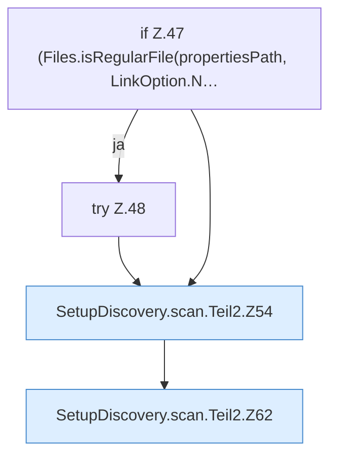

[[00 Start]] › [[Server-Anlage]] › [[Setup-Suche]] › [[SetupDiscovery]] › [[SetupDiscovery.scan]] › [[SetupDiscovery.scan.Teil2]]

# SetupDiscovery.scan.Teil2

- Fortsetzung von `SetupDiscovery.scan`, Quellreihenfolge.
