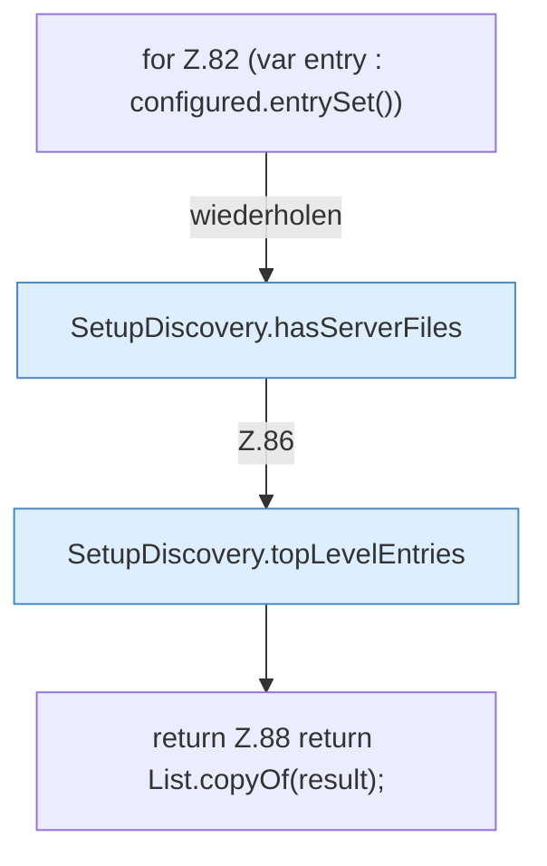

[[00 Start]] › [[Server-Anlage]] › [[Setup-Suche]] › [[SetupDiscovery]] › [[SetupDiscovery.scan]] › [[SetupDiscovery.scan.Teil3]]

# SetupDiscovery.scan.Teil3



```knoten
for Z.82 (var entry : configured.entrySet())
  Zeile 82: Schleife `(var entry : configured.entrySet())`.
SetupDiscovery.hasServerFiles
  Dieser Teil prüft den Server die Dateien. Prüft `hasServerFiles`.
SetupDiscovery.topLevelEntries
  Dieser Teil macht hier einen einzelnen Schritt. Eine Ebene tiefer steht er genauer. `topLevelEntries` in `SetupDiscovery.java`.
return Z.88 return List.copyOf(result);
  Zeile 88: Rückgabe `return List.copyOf(result);`.
```

> [!knoten]- Was die Blöcke tun
> - **for Z.82 (var entry : configured.entrySet())**: Zeile 82: Schleife `(var entry : configured.entrySet())`.
> - **SetupDiscovery.hasServerFiles**: Dieser Teil prüft den Server die Dateien. Prüft `hasServerFiles`.
> - **SetupDiscovery.topLevelEntries**: Dieser Teil macht hier einen einzelnen Schritt. Eine Ebene tiefer steht er genauer. `topLevelEntries` in `SetupDiscovery.java`.
> - **return Z.88 return List.copyOf(result);**: Zeile 88: Rückgabe `return List.copyOf(result);`.

- Ein weiterer Abschnitt derselben Übersicht.
- Fortsetzung von `SetupDiscovery.scan`.
