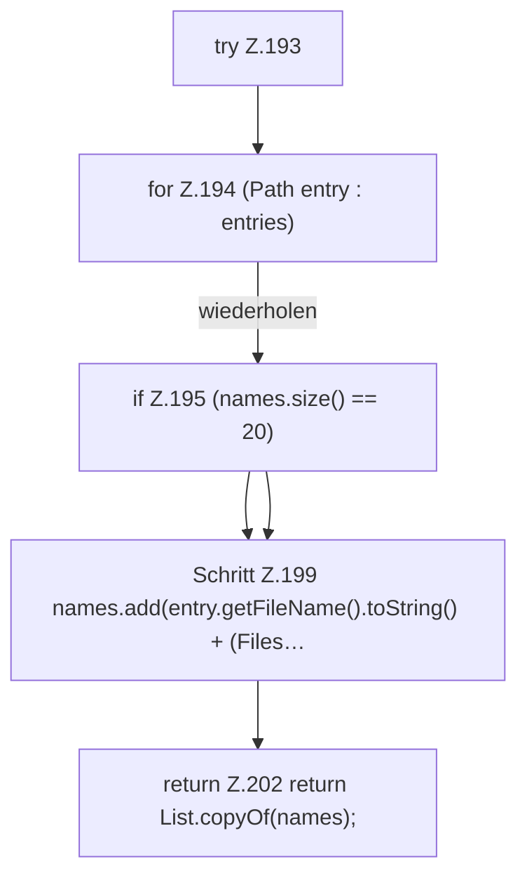

[[00 Start]] › [[Server-Anlage]] › [[Setup-Suche]] › [[SetupDiscovery]] › [[SetupDiscovery.topLevelEntries]]

# SetupDiscovery.topLevelEntries

`SetupDiscovery.topLevelEntries(Path path)` [src/main/java/de/aichele/childlauncher/SetupDiscovery.java:191–203](https://github.com/Sciddie/minecraft-serverhoster-plugin/blob/95b02b953b0b4c23673e900e021a7c3c844aa37d/src/main/java/de/aichele/childlauncher/SetupDiscovery.java#L191-L203)



```knoten
try Z.193
  Zeile 193: Versuch. Der Fehlerpfad geht in catch.
for Z.194 (Path entry : entries)
  Zeile 194: Schleife `(Path entry : entries)`.
if Z.195 (names.size() == 20)
  Zeile 195: prüft `(names.size() == 20)`.
Schritt Z.199 names.add(entry.getFileName().toString() + (Files…
  Zeile 199: `names.add(entry.getFileName().toString() + (Files…`
return Z.202 return List.copyOf(names);
  Zeile 202: Rückgabe `return List.copyOf(names);`.
```

- `topLevelEntries` in `src/main/java/de/aichele/childlauncher/SetupDiscovery.java`
