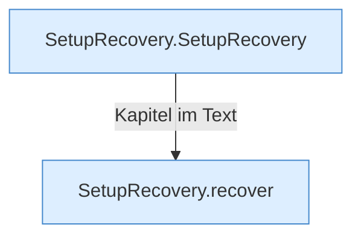

[[00 Start]] › [[Server-Anlage]] › [[Setup-Suche]] › [[SetupRecovery]]

# SetupRecovery



```knoten
SetupRecovery.SetupRecovery
  Dieser Teil kümmert sich um die Wiederherstellung. Im [[Glossar#Quelltext|Quelltext]] heißt das `SetupRecovery`.
SetupRecovery.recover
  Dieser Teil rückt wieder gerade das. Im [[Glossar#Quelltext|Quelltext]] heißt das `recover`.
```

> [!knoten]- Was die Blöcke tun
> - **SetupRecovery.SetupRecovery**: Dieser Teil kümmert sich um die Wiederherstellung. Im [[Glossar#Quelltext|Quelltext]] heißt das `SetupRecovery`.
> - **SetupRecovery.recover**: Dieser Teil rückt wieder gerade das. Im [[Glossar#Quelltext|Quelltext]] heißt das `recover`.

- Macht aus so einem Treffer wieder eine Anlage, die das [[Glossar#Plugin|Plugin]] benutzen kann.
