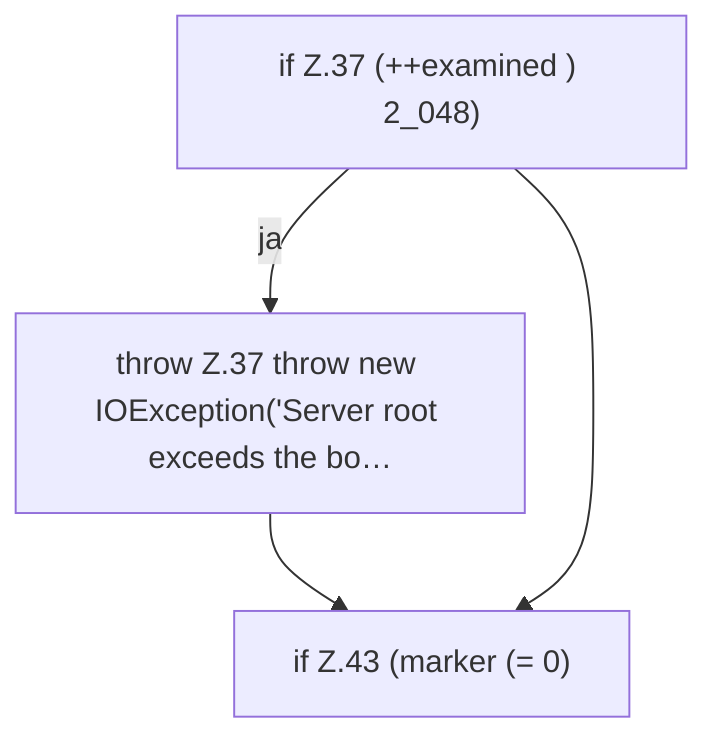

[[00 Start]] › [[Server-Anlage]] › [[Setup-Suche]] › [[SetupRecovery]] › [[SetupRecovery.recover]] › [[SetupRecovery.recover.Z34.Z36.Teil1]]

# SetupRecovery.recover.Z34.Z36.Teil1



```knoten
if Z.37 (++examined ) 2_048)
  Zeile 37: prüft `(++examined ) 2_048)`.
throw Z.37 throw new IOException('Server root exceeds the bo…
  Zeile 37: Abbruch `throw new IOException('Server root exceeds the bo…`.
if Z.43 (marker (= 0)
  Zeile 43: prüft `(marker (= 0)`.
```

> [!knoten]- Was die Blöcke tun
> - **if Z.37 (++examined ) 2_048)**: Zeile 37: prüft `(++examined ) 2_048)`.
> - **throw Z.37 throw new IOException('Server root exceeds the bo…**: Zeile 37: Abbruch `throw new IOException('Server root exceeds the bo…`.
> - **if Z.43 (marker (= 0)**: Zeile 43: prüft `(marker (= 0)`.

- Ein weiterer Abschnitt derselben Übersicht.
- Fortsetzung von `SetupRecovery.recover.Z34.Z36`.
