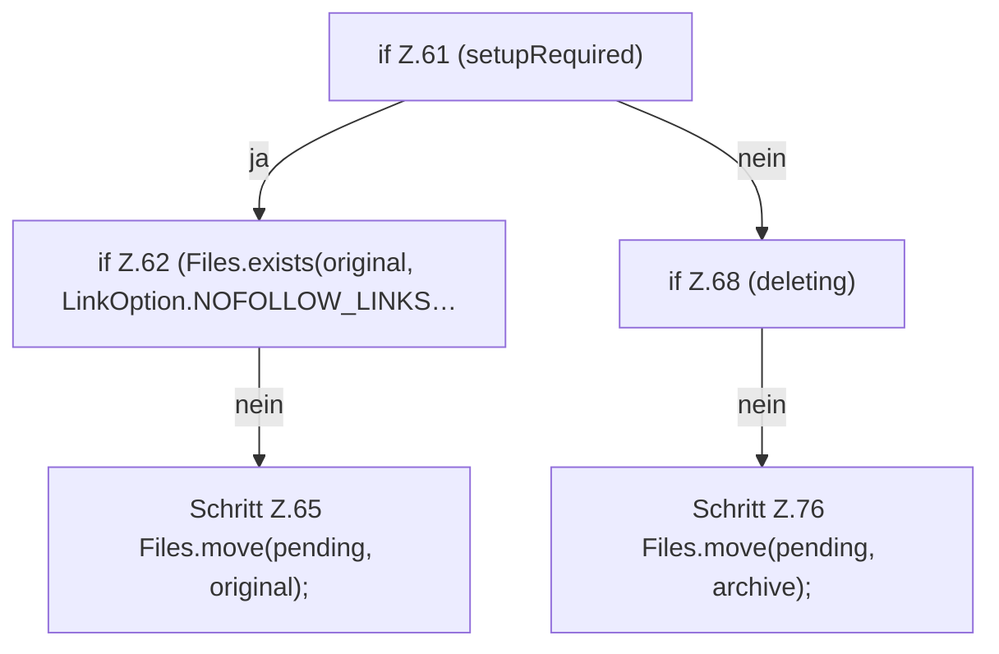

[[00 Start]] › [[Server-Anlage]] › [[Setup-Suche]] › [[SetupRecovery]] › [[SetupRecovery.recover]] › [[SetupRecovery.recover.Z34.Z36.Teil2.Z61]]

# SetupRecovery.recover.Z34.Z36.Teil2.Z61



```knoten
if Z.61 (setupRequired)
  Zeile 61: prüft `(setupRequired)`.
if Z.62 (Files.exists(original, LinkOption.NOFOLLOW_LINKS…
  Zeile 62: prüft `(Files.exists(original, LinkOption.NOFOLLOW_LINKS…`.
Schritt Z.65 Files.move(pending, original);
  Zeile 65: Dateioperation. `Files.move(pending, original);`
if Z.68 (deleting)
  Zeile 68: prüft `(deleting)`.
Schritt Z.76 Files.move(pending, archive);
  Zeile 76: Dateioperation. `Files.move(pending, archive);`
```

> [!knoten]- Was die Blöcke tun
> - **if Z.61 (setupRequired)**: Zeile 61: prüft `(setupRequired)`.
> - **if Z.62 (Files.exists(original, LinkOption.NOFOLLOW_LINKS…**: Zeile 62: prüft `(Files.exists(original, LinkOption.NOFOLLOW_LINKS…`.
> - **Schritt Z.65 Files.move(pending, original);**: Zeile 65: Dateioperation. `Files.move(pending, original);`
> - **if Z.68 (deleting)**: Zeile 68: prüft `(deleting)`.
> - **Schritt Z.76 Files.move(pending, archive);**: Zeile 76: Dateioperation. `Files.move(pending, archive);`

- Der Ablauf geht in [[Glossar#Zeile|Zeile]] 61 weiter. Eine Ebene tiefer steht er genauer.
- Fortsetzung von `SetupRecovery.recover.Z34.Z36.Teil2`.
