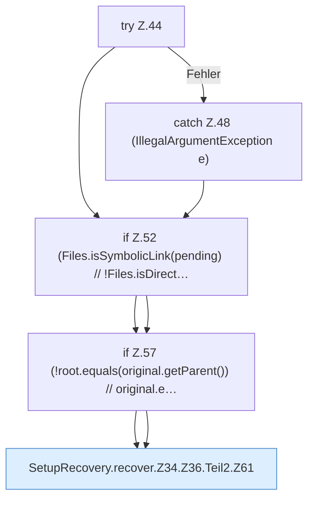

[[00 Start]] › [[Server-Anlage]] › [[Setup-Suche]] › [[SetupRecovery]] › [[SetupRecovery.recover]] › [[SetupRecovery.recover.Z34.Z36.Teil2]]

# SetupRecovery.recover.Z34.Z36.Teil2



```knoten
try Z.44
  Zeile 44: Versuch. Der Fehlerpfad geht in catch.
catch Z.48 (IllegalArgumentException e)
  Zeile 48: fängt (IllegalArgumentException e).
if Z.52 (Files.isSymbolicLink(pending) // !Files.isDirect…
  Zeile 52: prüft `(Files.isSymbolicLink(pending) // !Files.isDirect…`.
if Z.57 (!root.equals(original.getParent()) // original.e…
  Zeile 57: prüft `(!root.equals(original.getParent()) // original.e…`.
SetupRecovery.recover.Z34.Z36.Teil2.Z61
  Der Ablauf geht in [[Glossar#Zeile|Zeile]] 61 weiter. Eine Ebene tiefer steht er genauer. Fortsetzung des Ablaufs ab Zeile 61.
```

> [!knoten]- Was die Blöcke tun
> - **try Z.44**: Zeile 44: Versuch. Der Fehlerpfad geht in catch.
> - **catch Z.48 (IllegalArgumentException e)**: Zeile 48: fängt (IllegalArgumentException e).
> - **if Z.52 (Files.isSymbolicLink(pending) // !Files.isDirect…**: Zeile 52: prüft `(Files.isSymbolicLink(pending) // !Files.isDirect…`.
> - **if Z.57 (!root.equals(original.getParent()) // original.e…**: Zeile 57: prüft `(!root.equals(original.getParent()) // original.e…`.
> - **SetupRecovery.recover.Z34.Z36.Teil2.Z61**: Der Ablauf geht in [[Glossar#Zeile|Zeile]] 61 weiter. Eine Ebene tiefer steht er genauer. Fortsetzung des Ablaufs ab Zeile 61.

- Ein weiterer Abschnitt derselben Übersicht.
- Fortsetzung von `SetupRecovery.recover.Z34.Z36`.
