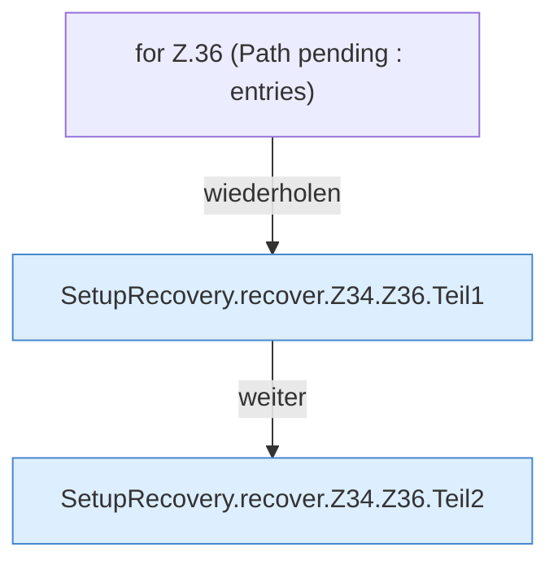

[[00 Start]] › [[Server-Anlage]] › [[Setup-Suche]] › [[SetupRecovery]] › [[SetupRecovery.recover]] › [[SetupRecovery.recover.Z34.Z36]]

# SetupRecovery.recover.Z34.Z36



```knoten
for Z.36 (Path pending : entries)
  Zeile 36: Schleife `(Path pending : entries)`.
SetupRecovery.recover.Z34.Z36.Teil1
  Ein weiterer Abschnitt derselben Übersicht. Abschnitt 1 dieses Ablaufs, in Quellreihenfolge.
SetupRecovery.recover.Z34.Z36.Teil2
  Ein weiterer Abschnitt derselben Übersicht. Abschnitt 2 dieses Ablaufs, in Quellreihenfolge.
```

> [!knoten]- Was die Blöcke tun
> - **for Z.36 (Path pending : entries)**: Zeile 36: Schleife `(Path pending : entries)`.
> - **SetupRecovery.recover.Z34.Z36.Teil1**: Ein weiterer Abschnitt derselben Übersicht. Abschnitt 1 dieses Ablaufs, in Quellreihenfolge.
> - **SetupRecovery.recover.Z34.Z36.Teil2**: Ein weiterer Abschnitt derselben Übersicht. Abschnitt 2 dieses Ablaufs, in Quellreihenfolge.

- Der Ablauf geht in [[Glossar#Zeile|Zeile]] 36 weiter. Eine Ebene tiefer steht er genauer.
- Fortsetzung von `SetupRecovery.recover.Z34`.
