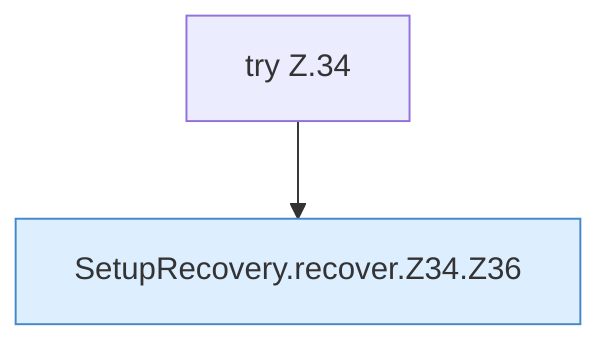

[[00 Start]] › [[Server-Anlage]] › [[Setup-Suche]] › [[SetupRecovery]] › [[SetupRecovery.recover]] › [[SetupRecovery.recover.Z34]]

# SetupRecovery.recover.Z34

- Fortsetzung von `SetupRecovery.recover`, Quellreihenfolge.
