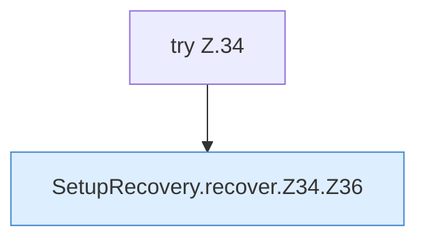

[[00 Start]] › [[Server-Anlage]] › [[Setup-Suche]] › [[SetupRecovery]] › [[SetupRecovery.recover]] › [[SetupRecovery.recover.Z34]]

# SetupRecovery.recover.Z34



```knoten
try Z.34
  Zeile 34: Versuch. Der Fehlerpfad geht in catch.
SetupRecovery.recover.Z34.Z36
  Der Ablauf geht in [[Glossar#Zeile|Zeile]] 36 weiter. Eine Ebene tiefer steht er genauer. Fortsetzung des Ablaufs ab Zeile 36.
```

> [!knoten]- Was die Blöcke tun
> - **try Z.34**: Zeile 34: Versuch. Der Fehlerpfad geht in catch.
> - **SetupRecovery.recover.Z34.Z36**: Der Ablauf geht in [[Glossar#Zeile|Zeile]] 36 weiter. Eine Ebene tiefer steht er genauer. Fortsetzung des Ablaufs ab Zeile 36.

- Der Ablauf geht in [[Glossar#Zeile|Zeile]] 34 weiter. Eine Ebene tiefer steht er genauer.
- Fortsetzung von `SetupRecovery.recover`.
