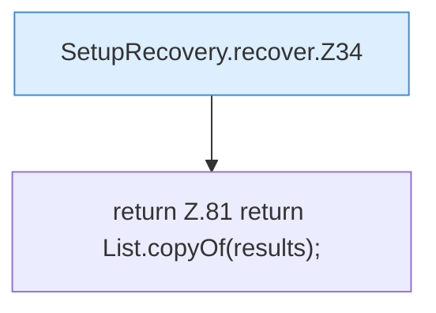

[[00 Start]] › [[Server-Anlage]] › [[Setup-Suche]] › [[SetupRecovery]] › [[SetupRecovery.recover]]

# SetupRecovery.recover

`SetupRecovery.recover(Path serverRoot, boolean setupRequired, Deleter deleter)` [src/main/java/de/aichele/childlauncher/SetupRecovery.java:31–82](https://github.com/Sciddie/minecraft-serverhoster-plugin/blob/95b02b953b0b4c23673e900e021a7c3c844aa37d/src/main/java/de/aichele/childlauncher/SetupRecovery.java#L31-L82)

- `recover` in `src/main/java/de/aichele/childlauncher/SetupRecovery.java`
