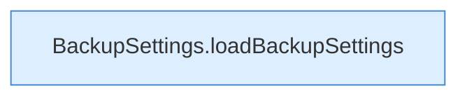

[[00 Start]] › [[Dashboard-UI]] › [[UI-Workflows]] › [[SetupWizard]] › [[SetupWizard.SetupWizard]] › [[SetupWizard.SetupWizard.Teil3]]

# SetupWizard.SetupWizard.Teil3



```knoten
BackupSettings.loadBackupSettings
  Lädt `loadBackupSettings`. Ruft `dashboardRequest`.
```

- Fortsetzung von `SetupWizard.SetupWizard`, Quellreihenfolge.
