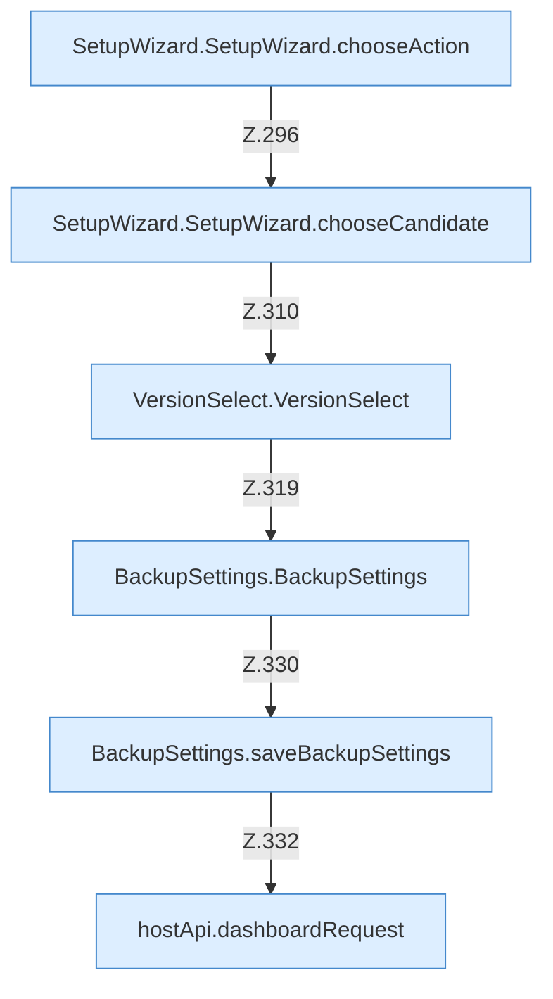

[[00 Start]] › [[Dashboard-UI]] › [[UI-Workflows]] › [[SetupWizard]] › [[SetupWizard.SetupWizard]] › [[SetupWizard.SetupWizard.Teil4.Calls283]]

# SetupWizard.SetupWizard.Teil4.Calls283



```knoten
SetupWizard.SetupWizard.chooseAction
  Der [[Glossar#Assistent|Assistent]] wählt die Tätigkeit. Wählt `chooseAction`.
SetupWizard.SetupWizard.chooseCandidate
  Der [[Glossar#Assistent|Assistent]] wählt hier einen Schritt. Eine Ebene tiefer steht er genauer. Wählt `chooseCandidate`.
VersionSelect.VersionSelect
  Die [[Glossar#Bedienseite|Bedienseite]] wählt das. `VersionSelect` in `VersionSelect.tsx`.
BackupSettings.BackupSettings
  Dieser Teil sichert die [[Glossar#Einstellungen|Einstellungen]]. Sichert `BackupSettings`.
BackupSettings.saveBackupSettings
  Dieser Teil speichert die [[Glossar#Sicherungskopie|Sicherungskopie]] die [[Glossar#Einstellungen|Einstellungen]]. Speichert `saveBackupSettings`. Ruft `dashboardRequest`, `jsonBody`.
hostApi.dashboardRequest
  Schickt von der [[Glossar#Bedienseite|Bedienseite]] eine Anfrage an das [[Glossar#Plugin|Plugin]]. `dashboardRequest` in `hostApi.ts`.
```

> [!knoten]- Was die Blöcke tun
> - **SetupWizard.SetupWizard.chooseAction**: Der [[Glossar#Assistent|Assistent]] wählt die Tätigkeit. Wählt `chooseAction`.
> - **SetupWizard.SetupWizard.chooseCandidate**: Der [[Glossar#Assistent|Assistent]] wählt hier einen Schritt. Eine Ebene tiefer steht er genauer. Wählt `chooseCandidate`.
> - **VersionSelect.VersionSelect**: Die [[Glossar#Bedienseite|Bedienseite]] wählt das. `VersionSelect` in `VersionSelect.tsx`.
> - **BackupSettings.BackupSettings**: Dieser Teil sichert die [[Glossar#Einstellungen|Einstellungen]]. Sichert `BackupSettings`.
> - **BackupSettings.saveBackupSettings**: Dieser Teil speichert die [[Glossar#Sicherungskopie|Sicherungskopie]] die [[Glossar#Einstellungen|Einstellungen]]. Speichert `saveBackupSettings`. Ruft `dashboardRequest`, `jsonBody`.
> - **hostApi.dashboardRequest**: Schickt von der [[Glossar#Bedienseite|Bedienseite]] eine Anfrage an das [[Glossar#Plugin|Plugin]]. `dashboardRequest` in `hostApi.ts`.

- Weitere [[Glossar#Funktion|Funktionen]], die ab [[Glossar#Zeile|Zeile]] 283 aufgerufen werden.
- Fortsetzung von `SetupWizard.SetupWizard.Teil4`.
