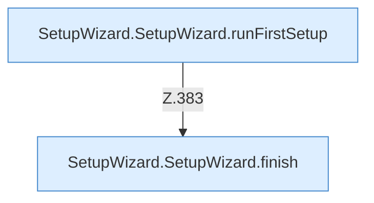

[[00 Start]] › [[Dashboard-UI]] › [[UI-Workflows]] › [[SetupWizard]] › [[SetupWizard.SetupWizard]] › [[SetupWizard.SetupWizard.Teil4.Calls360]]

# SetupWizard.SetupWizard.Teil4.Calls360



```knoten
SetupWizard.SetupWizard.runFirstSetup
  Der [[Glossar#Assistent|Assistent]] führt aus die erste die [[Glossar#Einrichtung|Einrichtung]]. Führt aus `runFirstSetup`. Ruft `dashboardRequest`, `jsonBody`.
SetupWizard.SetupWizard.finish
  Der [[Glossar#Assistent|Assistent]] beendet das. Schließt ab `finish`. Ruft `saveBackupSettings`, `createSchedule`, `dashboardRequest`.
```

> [!knoten]- Was die Blöcke tun
> - **SetupWizard.SetupWizard.runFirstSetup**: Der [[Glossar#Assistent|Assistent]] führt aus die erste die [[Glossar#Einrichtung|Einrichtung]]. Führt aus `runFirstSetup`. Ruft `dashboardRequest`, `jsonBody`.
> - **SetupWizard.SetupWizard.finish**: Der [[Glossar#Assistent|Assistent]] beendet das. Schließt ab `finish`. Ruft `saveBackupSettings`, `createSchedule`, `dashboardRequest`.

- Weitere [[Glossar#Funktion|Funktionen]], die ab [[Glossar#Zeile|Zeile]] 360 aufgerufen werden.
- Fortsetzung von `SetupWizard.SetupWizard.Teil4`.
