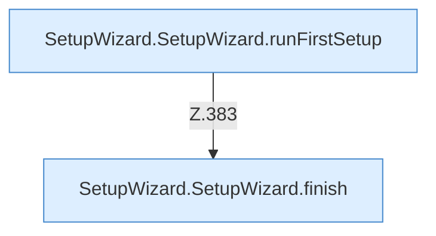

[[00 Start]] › [[Dashboard-UI]] › [[UI-Workflows]] › [[SetupWizard]] › [[SetupWizard.SetupWizard]] › [[SetupWizard.SetupWizard.Teil4.Calls360]]

# SetupWizard.SetupWizard.Teil4.Calls360

- Fortsetzung von `SetupWizard.SetupWizard.Teil4`, Quellreihenfolge.
