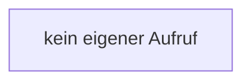

[[00 Start]] › [[Dashboard-UI]] › [[UI-Workflows]] › [[SetupWizard]] › [[SetupWizard.SetupWizard]] › [[SetupWizard.SetupWizard.chooseAction]]

# SetupWizard.SetupWizard.chooseAction

`SetupWizard.chooseAction(value: Action)` [ui/src/components/SetupWizard.tsx:92–96](https://github.com/Sciddie/minecraft-serverhoster-plugin/blob/95b02b953b0b4c23673e900e021a7c3c844aa37d/ui/src/components/SetupWizard.tsx#L92-L96)



```knoten
kein eigener Aufruf
  In diesem Stück gibt es keinen weiteren eigenen Aufruf.
```

> [!knoten]- Was die Blöcke tun
> - **kein eigener Aufruf**: In diesem Stück gibt es keinen weiteren eigenen Aufruf.

- Der [[Glossar#Assistent|Assistent]] wählt die Tätigkeit.
- `chooseAction` in `ui/src/components/SetupWizard.tsx`
