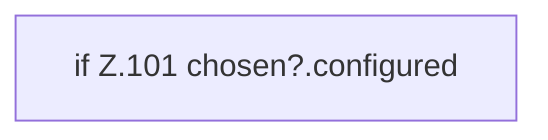

[[00 Start]] › [[Dashboard-UI]] › [[UI-Workflows]] › [[SetupWizard]] › [[SetupWizard.SetupWizard]] › [[SetupWizard.SetupWizard.chooseCandidate]]

# SetupWizard.SetupWizard.chooseCandidate

`SetupWizard.chooseCandidate(value: string)` [ui/src/components/SetupWizard.tsx:98–106](https://github.com/Sciddie/minecraft-serverhoster-plugin/blob/95b02b953b0b4c23673e900e021a7c3c844aa37d/ui/src/components/SetupWizard.tsx#L98-L106)



```knoten
if Z.101 chosen?.configured
  Zeile 101: prüft `chosen?.configured`.
```

> [!knoten]- Was die Blöcke tun
> - **if Z.101 chosen?.configured**: Zeile 101: prüft `chosen?.configured`.

- Der [[Glossar#Assistent|Assistent]] wählt hier einen Schritt. Eine Ebene tiefer steht er genauer.
- `chooseCandidate` in `ui/src/components/SetupWizard.tsx`
