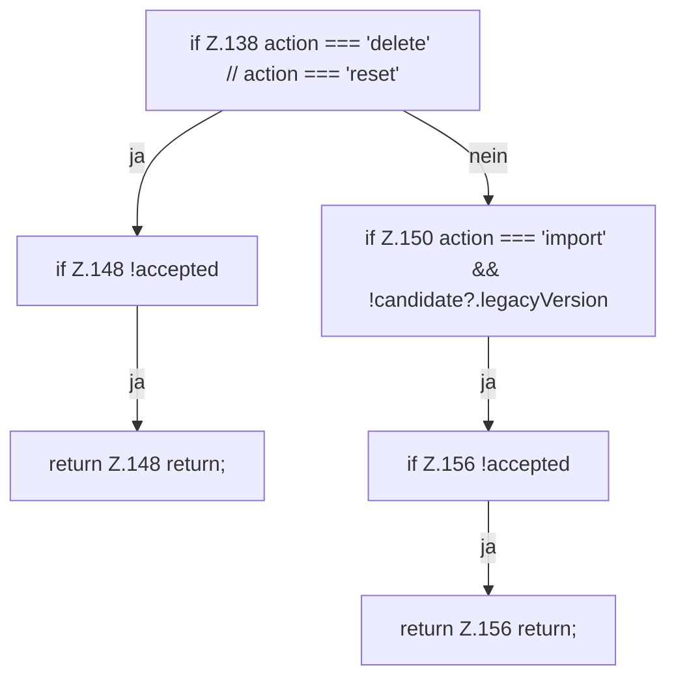

[[00 Start]] › [[Dashboard-UI]] › [[UI-Workflows]] › [[SetupWizard]] › [[SetupWizard.SetupWizard]] › [[SetupWizard.SetupWizard.finish]] › [[SetupWizard.SetupWizard.finish.Z135.Teil1.Z138]]

# SetupWizard.SetupWizard.finish.Z135.Teil1.Z138



```knoten
if Z.138 action === 'delete' // action === 'reset'
  Zeile 138: prüft `action === 'delete' // action === 'reset'`.
if Z.148 !accepted
  Zeile 148: prüft `!accepted`.
return Z.148 return;
  Zeile 148: Rückgabe `return;`.
if Z.150 action === 'import' && !candidate?.legacyVersion
  Zeile 150: prüft `action === 'import' && !candidate?.legacyVersion`.
if Z.156 !accepted
  Zeile 156: prüft `!accepted`.
return Z.156 return;
  Zeile 156: Rückgabe `return;`.
```

> [!knoten]- Was die Blöcke tun
> - **if Z.138 action === 'delete' // action === 'reset'**: Zeile 138: prüft `action === 'delete' // action === 'reset'`.
> - **if Z.148 !accepted**: Zeile 148: prüft `!accepted`.
> - **return Z.148 return;**: Zeile 148: Rückgabe `return;`.
> - **if Z.150 action === 'import' && !candidate?.legacyVersion**: Zeile 150: prüft `action === 'import' && !candidate?.legacyVersion`.
> - **if Z.156 !accepted**: Zeile 156: prüft `!accepted`.
> - **return Z.156 return;**: Zeile 156: Rückgabe `return;`.

- Der Ablauf geht in [[Glossar#Zeile|Zeile]] 138 weiter. Eine Ebene tiefer steht er genauer.
- Fortsetzung von `SetupWizard.SetupWizard.finish.Z135.Teil1`.
