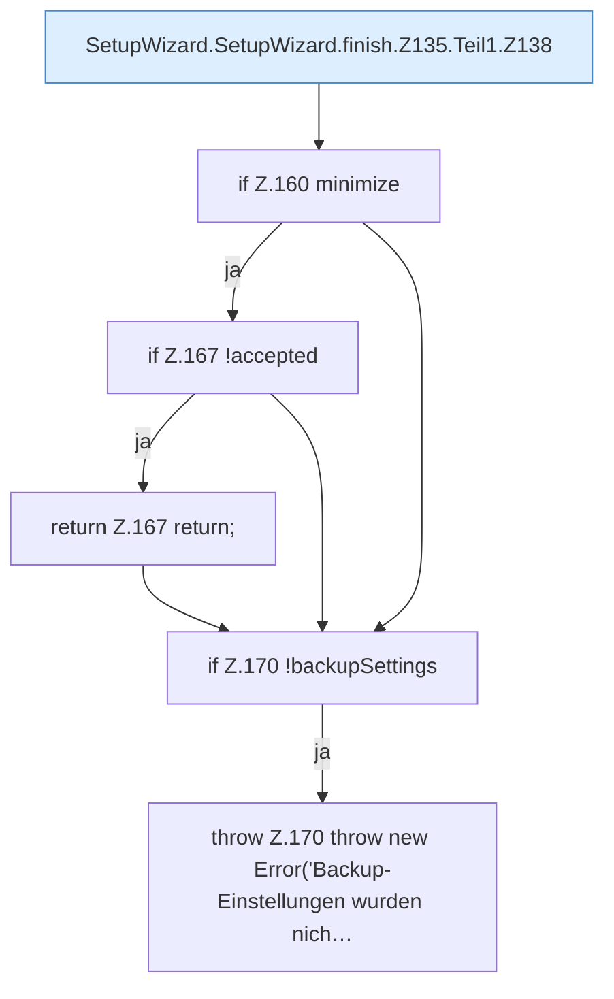

[[00 Start]] › [[Dashboard-UI]] › [[UI-Workflows]] › [[SetupWizard]] › [[SetupWizard.SetupWizard]] › [[SetupWizard.SetupWizard.finish]] › [[SetupWizard.SetupWizard.finish.Z135.Teil1]]

# SetupWizard.SetupWizard.finish.Z135.Teil1



```knoten
SetupWizard.SetupWizard.finish.Z135.Teil1.Z138
  Fortsetzung des Ablaufs ab Zeile 138.
if Z.160 minimize
  Zeile 160: prüft `minimize`.
if Z.167 !accepted
  Zeile 167: prüft `!accepted`.
return Z.167 return;
  Zeile 167: Rückgabe `return;`.
if Z.170 !backupSettings
  Zeile 170: prüft `!backupSettings`.
throw Z.170 throw new Error('Backup-Einstellungen wurden nich…
  Zeile 170: Abbruch `throw new Error('Backup-Einstellungen wurden nich…`.
```

- Fortsetzung von `SetupWizard.SetupWizard.finish.Z135`, Quellreihenfolge.
