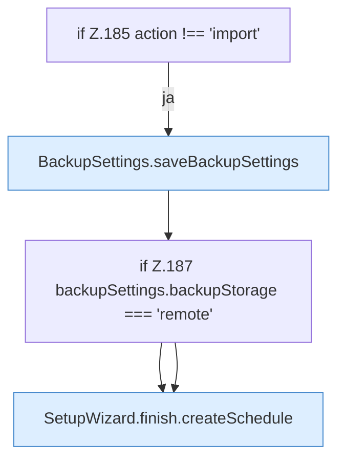

[[00 Start]] › [[Dashboard-UI]] › [[UI-Workflows]] › [[SetupWizard]] › [[SetupWizard.SetupWizard]] › [[SetupWizard.SetupWizard.finish]] › [[SetupWizard.SetupWizard.finish.Z135.Teil2.Z185]]

# SetupWizard.SetupWizard.finish.Z135.Teil2.Z185

- Fortsetzung von `SetupWizard.SetupWizard.finish.Z135.Teil2`, Quellreihenfolge.
