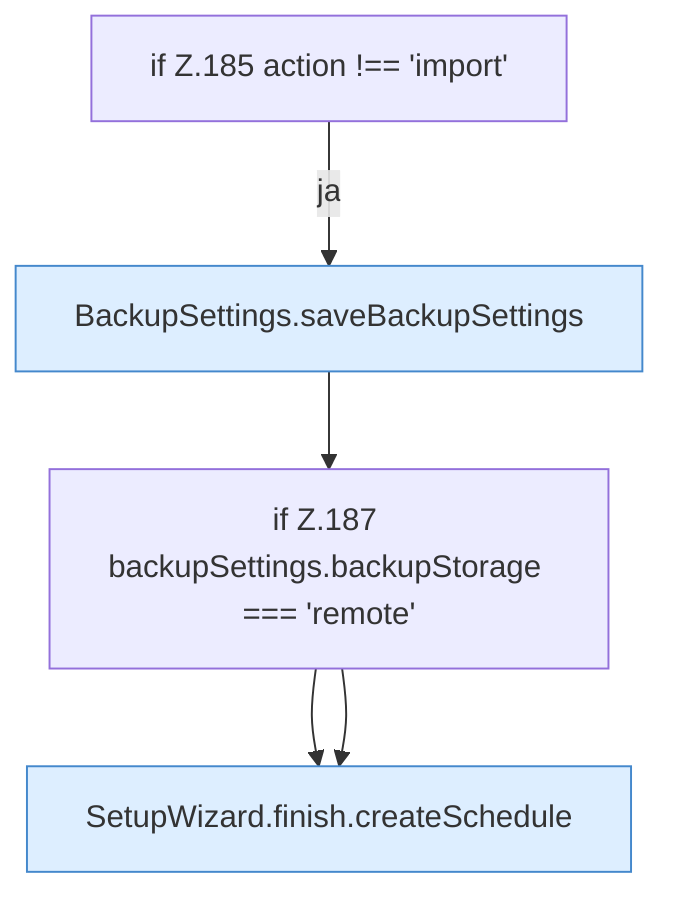

[[00 Start]] › [[Dashboard-UI]] › [[UI-Workflows]] › [[SetupWizard]] › [[SetupWizard.SetupWizard]] › [[SetupWizard.SetupWizard.finish]] › [[SetupWizard.SetupWizard.finish.Z135.Teil2.Z185]]

# SetupWizard.SetupWizard.finish.Z135.Teil2.Z185



```knoten
if Z.185 action !== 'import'
  Zeile 185: prüft `action !== 'import'`.
BackupSettings.saveBackupSettings
  Dieser Teil speichert die [[Glossar#Sicherungskopie|Sicherungskopie]] die [[Glossar#Einstellungen|Einstellungen]]. Speichert `saveBackupSettings`. Ruft `dashboardRequest`, `jsonBody`.
if Z.187 backupSettings.backupStorage === 'remote'
  Zeile 187: prüft `backupSettings.backupStorage === 'remote'`.
SetupWizard.finish.createSchedule
  Der [[Glossar#Assistent|Assistent]] legt an den [[Glossar#Zeitplan|Zeitplan]]. Legt an `createSchedule`. Ruft `dashboardRequest`, `jsonBody`.
```

> [!knoten]- Was die Blöcke tun
> - **if Z.185 action !== 'import'**: Zeile 185: prüft `action !== 'import'`.
> - **BackupSettings.saveBackupSettings**: Dieser Teil speichert die [[Glossar#Sicherungskopie|Sicherungskopie]] die [[Glossar#Einstellungen|Einstellungen]]. Speichert `saveBackupSettings`. Ruft `dashboardRequest`, `jsonBody`.
> - **if Z.187 backupSettings.backupStorage === 'remote'**: Zeile 187: prüft `backupSettings.backupStorage === 'remote'`.
> - **SetupWizard.finish.createSchedule**: Der [[Glossar#Assistent|Assistent]] legt an den [[Glossar#Zeitplan|Zeitplan]]. Legt an `createSchedule`. Ruft `dashboardRequest`, `jsonBody`.

- Der Ablauf geht in [[Glossar#Zeile|Zeile]] 185 weiter. Eine Ebene tiefer steht er genauer.
- Fortsetzung von `SetupWizard.SetupWizard.finish.Z135.Teil2`.
