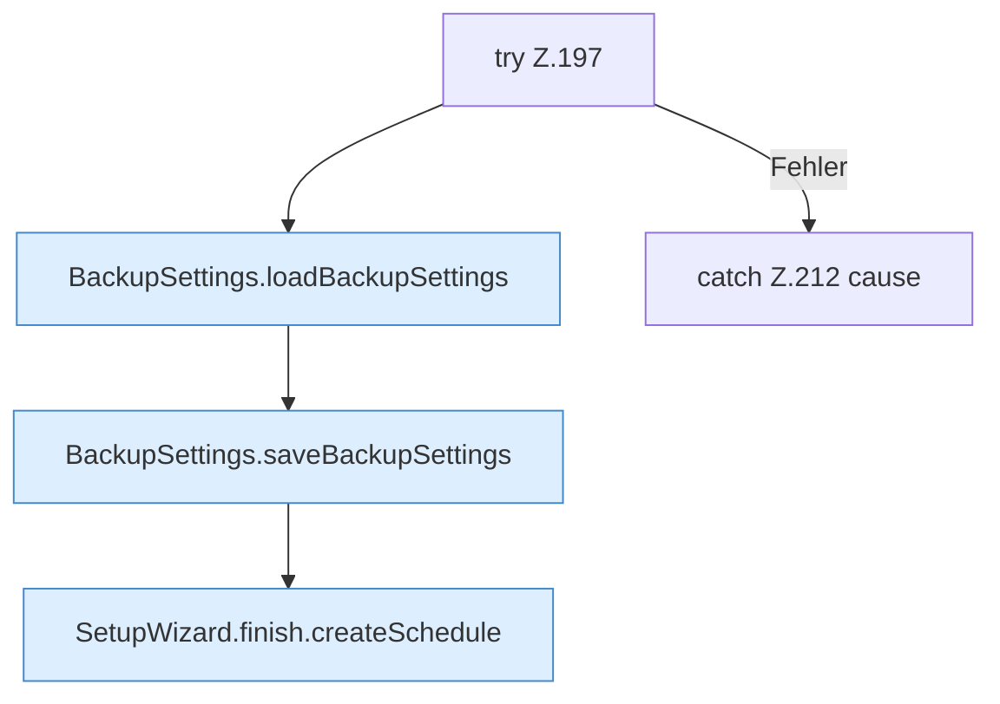

[[00 Start]] › [[Dashboard-UI]] › [[UI-Workflows]] › [[SetupWizard]] › [[SetupWizard.SetupWizard]] › [[SetupWizard.SetupWizard.finish]] › [[SetupWizard.SetupWizard.finish.Z135.Teil2.Z196.Z197]]

# SetupWizard.SetupWizard.finish.Z135.Teil2.Z196.Z197



```knoten
try Z.197
  Zeile 197: Versuch. Der Fehlerpfad geht in catch.
BackupSettings.loadBackupSettings
  Dieser Teil lädt die [[Glossar#Sicherungskopie|Sicherungskopie]] die [[Glossar#Einstellungen|Einstellungen]]. Lädt `loadBackupSettings`. Ruft `dashboardRequest`.
BackupSettings.saveBackupSettings
  Dieser Teil speichert die [[Glossar#Sicherungskopie|Sicherungskopie]] die [[Glossar#Einstellungen|Einstellungen]]. Speichert `saveBackupSettings`. Ruft `dashboardRequest`, `jsonBody`.
SetupWizard.finish.createSchedule
  Der [[Glossar#Assistent|Assistent]] legt an den [[Glossar#Zeitplan|Zeitplan]]. Legt an `createSchedule`. Ruft `dashboardRequest`, `jsonBody`.
catch Z.212 cause
  Zeile 212: fängt cause.
```

> [!knoten]- Was die Blöcke tun
> - **try Z.197**: Zeile 197: Versuch. Der Fehlerpfad geht in catch.
> - **BackupSettings.loadBackupSettings**: Dieser Teil lädt die [[Glossar#Sicherungskopie|Sicherungskopie]] die [[Glossar#Einstellungen|Einstellungen]]. Lädt `loadBackupSettings`. Ruft `dashboardRequest`.
> - **BackupSettings.saveBackupSettings**: Dieser Teil speichert die [[Glossar#Sicherungskopie|Sicherungskopie]] die [[Glossar#Einstellungen|Einstellungen]]. Speichert `saveBackupSettings`. Ruft `dashboardRequest`, `jsonBody`.
> - **SetupWizard.finish.createSchedule**: Der [[Glossar#Assistent|Assistent]] legt an den [[Glossar#Zeitplan|Zeitplan]]. Legt an `createSchedule`. Ruft `dashboardRequest`, `jsonBody`.
> - **catch Z.212 cause**: Zeile 212: fängt cause.

- Der Ablauf geht in [[Glossar#Zeile|Zeile]] 197 weiter. Eine Ebene tiefer steht er genauer.
- Fortsetzung von `SetupWizard.SetupWizard.finish.Z135.Teil2.Z196`.
