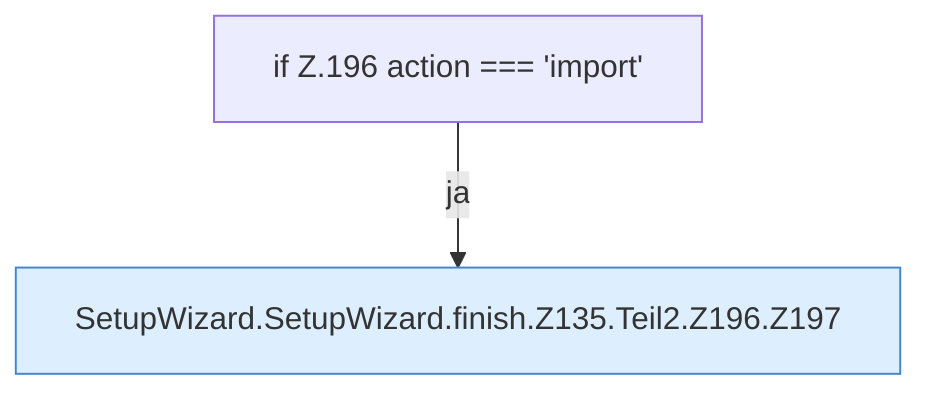

[[00 Start]] › [[Dashboard-UI]] › [[UI-Workflows]] › [[SetupWizard]] › [[SetupWizard.SetupWizard]] › [[SetupWizard.SetupWizard.finish]] › [[SetupWizard.SetupWizard.finish.Z135.Teil2.Z196]]

# SetupWizard.SetupWizard.finish.Z135.Teil2.Z196



```knoten
if Z.196 action === 'import'
  Zeile 196: prüft `action === 'import'`.
SetupWizard.SetupWizard.finish.Z135.Teil2.Z196.Z197
  Der Ablauf geht in [[Glossar#Zeile|Zeile]] 197 weiter. Eine Ebene tiefer steht er genauer. Fortsetzung des Ablaufs ab Zeile 197.
```

> [!knoten]- Was die Blöcke tun
> - **if Z.196 action === 'import'**: Zeile 196: prüft `action === 'import'`.
> - **SetupWizard.SetupWizard.finish.Z135.Teil2.Z196.Z197**: Der Ablauf geht in [[Glossar#Zeile|Zeile]] 197 weiter. Eine Ebene tiefer steht er genauer. Fortsetzung des Ablaufs ab Zeile 197.

- Der Ablauf geht in [[Glossar#Zeile|Zeile]] 196 weiter. Eine Ebene tiefer steht er genauer.
- Fortsetzung von `SetupWizard.SetupWizard.finish.Z135.Teil2`.
