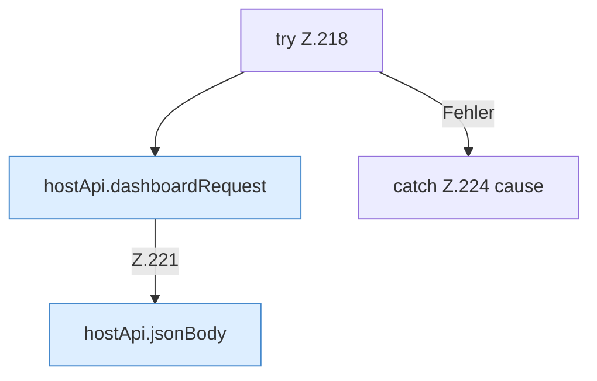

[[00 Start]] › [[Dashboard-UI]] › [[UI-Workflows]] › [[SetupWizard]] › [[SetupWizard.SetupWizard]] › [[SetupWizard.SetupWizard.finish]] › [[SetupWizard.SetupWizard.finish.Z135.Teil2.Z217.Z218]]

# SetupWizard.SetupWizard.finish.Z135.Teil2.Z217.Z218



```knoten
try Z.218
  Zeile 218: Versuch. Der Fehlerpfad geht in catch.
hostApi.dashboardRequest
  `dashboardRequest` in `hostApi.ts`.
hostApi.jsonBody
  Antwortet mit JSON `jsonBody`.
catch Z.224 cause
  Zeile 224: fängt cause.
```

- Fortsetzung von `SetupWizard.SetupWizard.finish.Z135.Teil2.Z217`, Quellreihenfolge.
