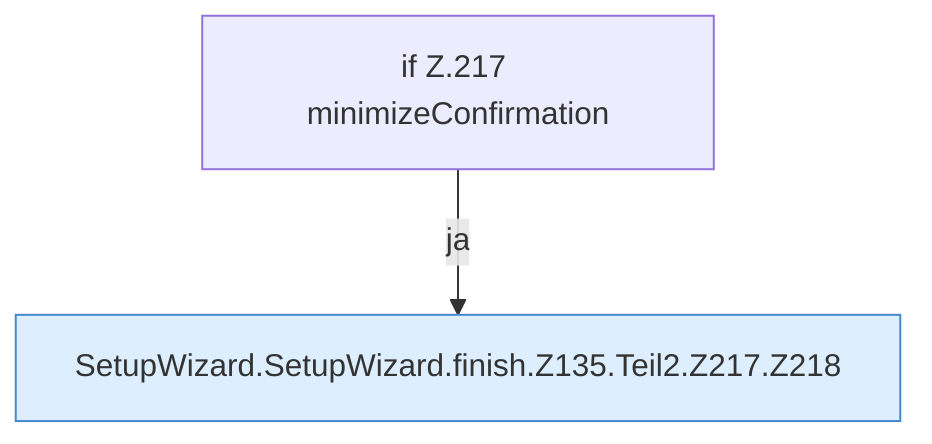

[[00 Start]] › [[Dashboard-UI]] › [[UI-Workflows]] › [[SetupWizard]] › [[SetupWizard.SetupWizard]] › [[SetupWizard.SetupWizard.finish]] › [[SetupWizard.SetupWizard.finish.Z135.Teil2.Z217]]

# SetupWizard.SetupWizard.finish.Z135.Teil2.Z217



```knoten
if Z.217 minimizeConfirmation
  Zeile 217: prüft `minimizeConfirmation`.
SetupWizard.SetupWizard.finish.Z135.Teil2.Z217.Z218
  Fortsetzung des Ablaufs ab Zeile 218.
```

- Fortsetzung von `SetupWizard.SetupWizard.finish.Z135.Teil2`, Quellreihenfolge.
