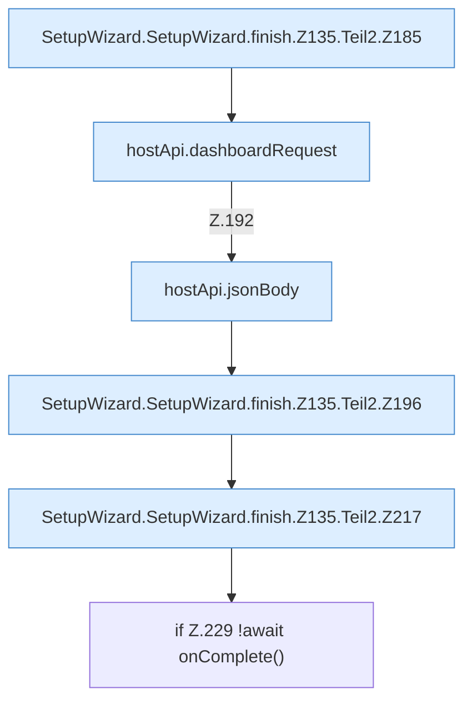

[[00 Start]] › [[Dashboard-UI]] › [[UI-Workflows]] › [[SetupWizard]] › [[SetupWizard.SetupWizard]] › [[SetupWizard.SetupWizard.finish]] › [[SetupWizard.SetupWizard.finish.Z135.Teil2]]

# SetupWizard.SetupWizard.finish.Z135.Teil2



```knoten
SetupWizard.SetupWizard.finish.Z135.Teil2.Z185
  Fortsetzung des Ablaufs ab Zeile 185.
hostApi.dashboardRequest
  `dashboardRequest` in `hostApi.ts`.
hostApi.jsonBody
  Antwortet mit JSON `jsonBody`.
SetupWizard.SetupWizard.finish.Z135.Teil2.Z196
  Fortsetzung des Ablaufs ab Zeile 196.
SetupWizard.SetupWizard.finish.Z135.Teil2.Z217
  Fortsetzung des Ablaufs ab Zeile 217.
if Z.229 !await onComplete()
  Zeile 229: prüft `!await onComplete()`.
```

- Fortsetzung von `SetupWizard.SetupWizard.finish.Z135`, Quellreihenfolge.
