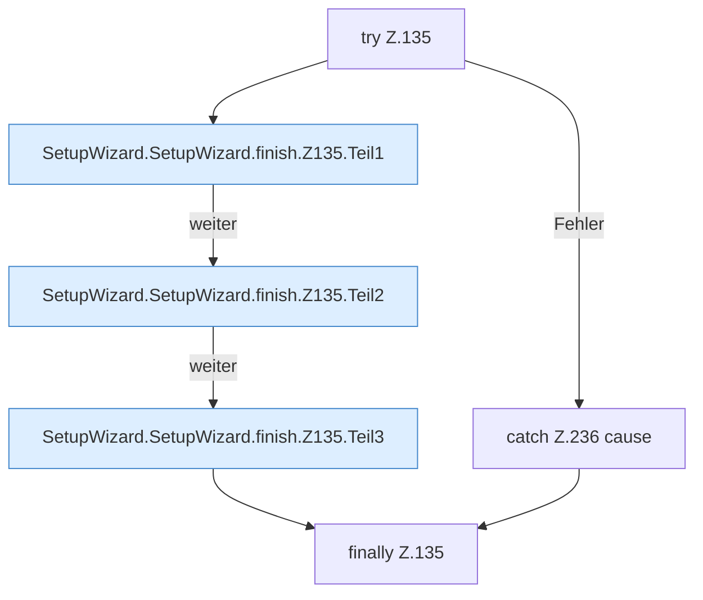

[[00 Start]] › [[Dashboard-UI]] › [[UI-Workflows]] › [[SetupWizard]] › [[SetupWizard.SetupWizard]] › [[SetupWizard.SetupWizard.finish]] › [[SetupWizard.SetupWizard.finish.Z135]]

# SetupWizard.SetupWizard.finish.Z135



```knoten
try Z.135
  Zeile 135: Versuch. Der Fehlerpfad geht in catch.
SetupWizard.SetupWizard.finish.Z135.Teil1
  Abschnitt 1 dieses Ablaufs, in Quellreihenfolge.
SetupWizard.SetupWizard.finish.Z135.Teil2
  Abschnitt 2 dieses Ablaufs, in Quellreihenfolge.
SetupWizard.SetupWizard.finish.Z135.Teil3
  Abschnitt 3 dieses Ablaufs, in Quellreihenfolge.
catch Z.236 cause
  Zeile 236: fängt cause.
finally Z.135
  Läuft danach immer, auch nach einem Fehler.
```

- Fortsetzung von `SetupWizard.SetupWizard.finish`, Quellreihenfolge.
