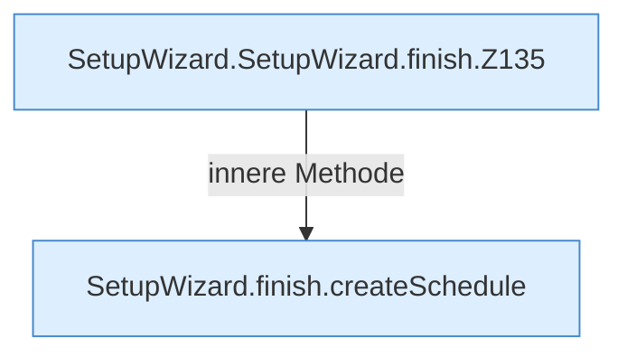

[[00 Start]] › [[Dashboard-UI]] › [[UI-Workflows]] › [[SetupWizard]] › [[SetupWizard.SetupWizard]] › [[SetupWizard.SetupWizard.finish]]

# SetupWizard.SetupWizard.finish

`SetupWizard.finish()` [ui/src/components/SetupWizard.tsx:132–241](https://github.com/Sciddie/minecraft-serverhoster-plugin/blob/95b02b953b0b4c23673e900e021a7c3c844aa37d/ui/src/components/SetupWizard.tsx#L132-L241)



```knoten
SetupWizard.SetupWizard.finish.Z135
  Der Ablauf geht in [[Glossar#Zeile|Zeile]] 135 weiter. Eine Ebene tiefer steht er genauer. Fortsetzung des Ablaufs ab Zeile 135.
SetupWizard.finish.createSchedule
  Der [[Glossar#Assistent|Assistent]] legt an den [[Glossar#Zeitplan|Zeitplan]]. Legt an `createSchedule`. Ruft `dashboardRequest`, `jsonBody`.
```

> [!knoten]- Was die Blöcke tun
> - **SetupWizard.SetupWizard.finish.Z135**: Der Ablauf geht in [[Glossar#Zeile|Zeile]] 135 weiter. Eine Ebene tiefer steht er genauer. Fortsetzung des Ablaufs ab Zeile 135.
> - **SetupWizard.finish.createSchedule**: Der [[Glossar#Assistent|Assistent]] legt an den [[Glossar#Zeitplan|Zeitplan]]. Legt an `createSchedule`. Ruft `dashboardRequest`, `jsonBody`.

- Der [[Glossar#Assistent|Assistent]] beendet das.
- `finish` in `ui/src/components/SetupWizard.tsx`
