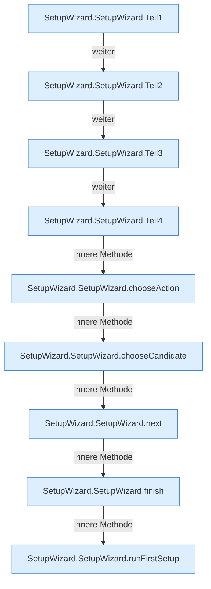

[[00 Start]] › [[Dashboard-UI]] › [[UI-Workflows]] › [[SetupWizard]] › [[SetupWizard.SetupWizard]]

# SetupWizard.SetupWizard

`SetupWizard.SetupWizard({ state, host, onComplete }: {
  state: SetupState;
  host: SetupHostState | null;
  onComplete: () => Promise<boolean>;
})` [ui/src/components/SetupWizard.tsx:45–388](https://github.com/Sciddie/minecraft-serverhoster-plugin/blob/95b02b953b0b4c23673e900e021a7c3c844aa37d/ui/src/components/SetupWizard.tsx#L45-L388)



```knoten
SetupWizard.SetupWizard.Teil1
  Abschnitt 1 dieses Ablaufs, in Quellreihenfolge.
SetupWizard.SetupWizard.Teil2
  Abschnitt 2 dieses Ablaufs, in Quellreihenfolge.
SetupWizard.SetupWizard.Teil3
  Abschnitt 3 dieses Ablaufs, in Quellreihenfolge.
SetupWizard.SetupWizard.Teil4
  Abschnitt 4 dieses Ablaufs, in Quellreihenfolge.
SetupWizard.SetupWizard.chooseAction
  Wählt `chooseAction`.
SetupWizard.SetupWizard.chooseCandidate
  Wählt `chooseCandidate`.
SetupWizard.SetupWizard.next
  Geht zum nächsten Schritt `next`. Ruft `versionIsValid`.
SetupWizard.SetupWizard.finish
  Schließt ab `finish`. Ruft `saveBackupSettings`, `createSchedule`, `dashboardRequest`.
SetupWizard.SetupWizard.runFirstSetup
  Führt aus `runFirstSetup`. Ruft `dashboardRequest`, `jsonBody`.
```

- `SetupWizard` in `ui/src/components/SetupWizard.tsx`
