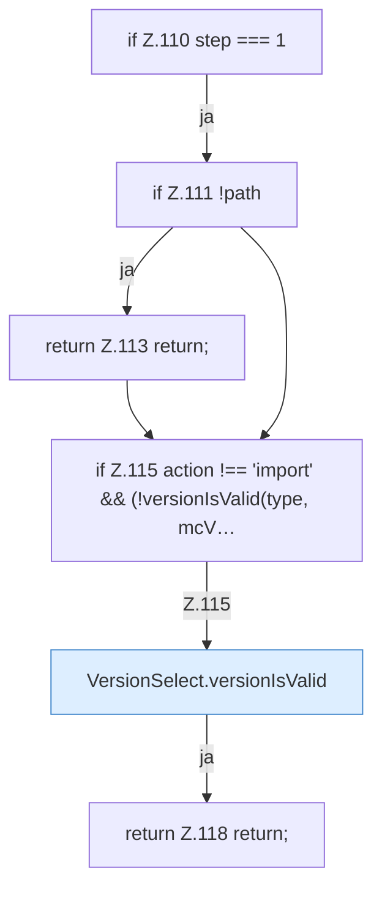

[[00 Start]] › [[Dashboard-UI]] › [[UI-Workflows]] › [[SetupWizard]] › [[SetupWizard.SetupWizard]] › [[SetupWizard.SetupWizard.next]] › [[SetupWizard.SetupWizard.next.Z110]]

# SetupWizard.SetupWizard.next.Z110



```knoten
if Z.110 step === 1
  Zeile 110: prüft `step === 1`.
if Z.111 !path
  Zeile 111: prüft `!path`.
return Z.113 return;
  Zeile 113: Rückgabe `return;`.
if Z.115 action !== 'import' && (!versionIsValid(type, mcV…
  Zeile 115: prüft `action !== 'import' && (!versionIsValid(type, mcV…`.
VersionSelect.versionIsValid
  Die [[Glossar#Bedienseite|Bedienseite]] prüft hier einen Schritt. Eine Ebene tiefer steht er genauer. `versionIsValid` in `VersionSelect.tsx`.
return Z.118 return;
  Zeile 118: Rückgabe `return;`.
```

> [!knoten]- Was die Blöcke tun
> - **if Z.110 step === 1**: Zeile 110: prüft `step === 1`.
> - **if Z.111 !path**: Zeile 111: prüft `!path`.
> - **return Z.113 return;**: Zeile 113: Rückgabe `return;`.
> - **if Z.115 action !== 'import' && (!versionIsValid(type, mcV…**: Zeile 115: prüft `action !== 'import' && (!versionIsValid(type, mcV…`.
> - **VersionSelect.versionIsValid**: Die [[Glossar#Bedienseite|Bedienseite]] prüft hier einen Schritt. Eine Ebene tiefer steht er genauer. `versionIsValid` in `VersionSelect.tsx`.
> - **return Z.118 return;**: Zeile 118: Rückgabe `return;`.

- Der Ablauf geht in [[Glossar#Zeile|Zeile]] 110 weiter. Eine Ebene tiefer steht er genauer.
- Fortsetzung von `SetupWizard.SetupWizard.next`.
