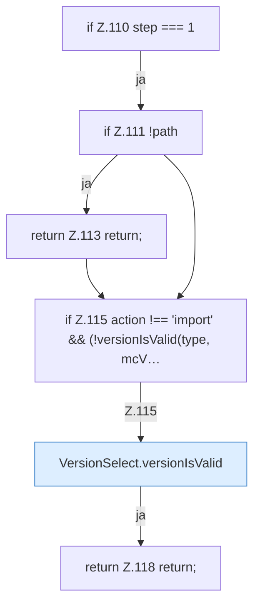

[[00 Start]] › [[Dashboard-UI]] › [[UI-Workflows]] › [[SetupWizard]] › [[SetupWizard.SetupWizard]] › [[SetupWizard.SetupWizard.next]] › [[SetupWizard.SetupWizard.next.Z110]]

# SetupWizard.SetupWizard.next.Z110

- Fortsetzung von `SetupWizard.SetupWizard.next`, Quellreihenfolge.
