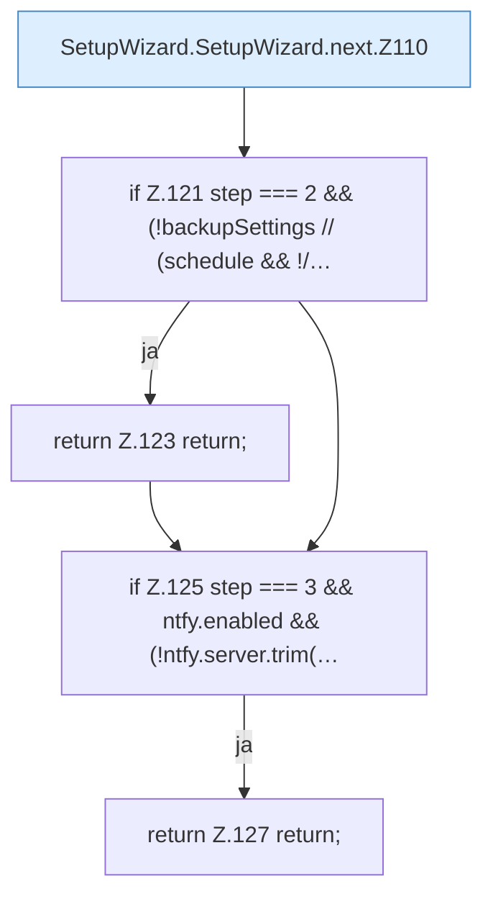

[[00 Start]] › [[Dashboard-UI]] › [[UI-Workflows]] › [[SetupWizard]] › [[SetupWizard.SetupWizard]] › [[SetupWizard.SetupWizard.next]]

# SetupWizard.SetupWizard.next

`SetupWizard.next()` [ui/src/components/SetupWizard.tsx:108–130](https://github.com/Sciddie/minecraft-serverhoster-plugin/blob/95b02b953b0b4c23673e900e021a7c3c844aa37d/ui/src/components/SetupWizard.tsx#L108-L130)

- `next` in `ui/src/components/SetupWizard.tsx`
