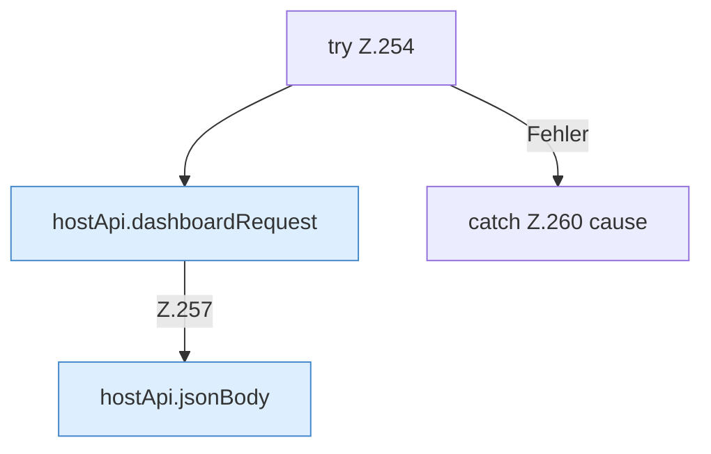

[[00 Start]] › [[Dashboard-UI]] › [[UI-Workflows]] › [[SetupWizard]] › [[SetupWizard.SetupWizard]] › [[SetupWizard.SetupWizard.runFirstSetup]] › [[SetupWizard.SetupWizard.runFirstSetup.Z254]]

# SetupWizard.SetupWizard.runFirstSetup.Z254

- Fortsetzung von `SetupWizard.SetupWizard.runFirstSetup`, Quellreihenfolge.
