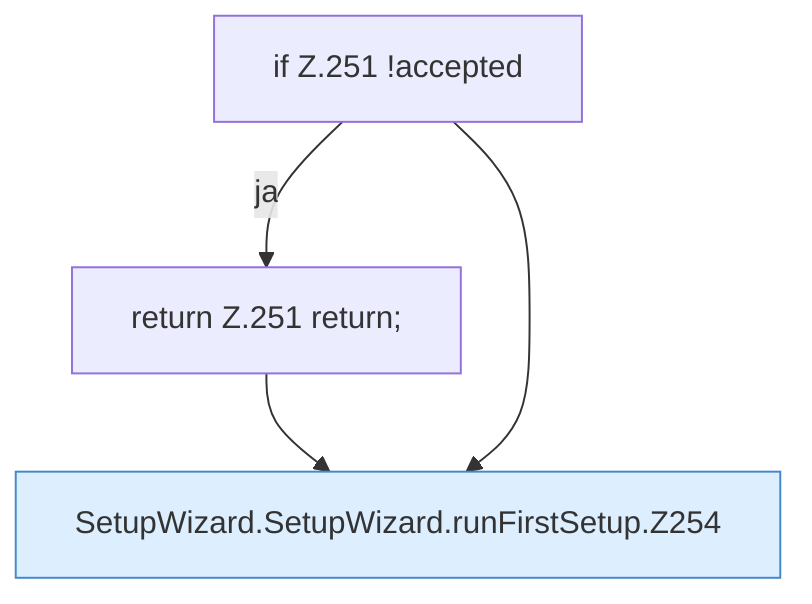

[[00 Start]] › [[Dashboard-UI]] › [[UI-Workflows]] › [[SetupWizard]] › [[SetupWizard.SetupWizard]] › [[SetupWizard.SetupWizard.runFirstSetup]]

# SetupWizard.SetupWizard.runFirstSetup

`SetupWizard.runFirstSetup()` [ui/src/components/SetupWizard.tsx:243–264](https://github.com/Sciddie/minecraft-serverhoster-plugin/blob/95b02b953b0b4c23673e900e021a7c3c844aa37d/ui/src/components/SetupWizard.tsx#L243-L264)



```knoten
if Z.251 !accepted
  Zeile 251: prüft `!accepted`.
return Z.251 return;
  Zeile 251: Rückgabe `return;`.
SetupWizard.SetupWizard.runFirstSetup.Z254
  Fortsetzung des Ablaufs ab Zeile 254.
```

- `runFirstSetup` in `ui/src/components/SetupWizard.tsx`
