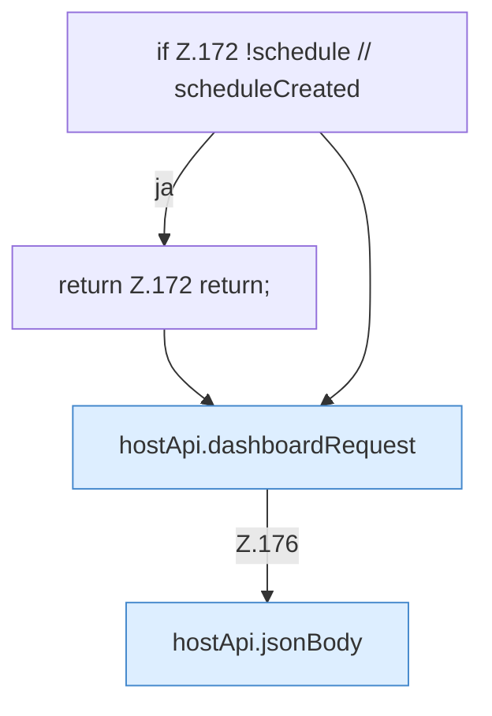

[[00 Start]] › [[Dashboard-UI]] › [[UI-Workflows]] › [[SetupWizard]] › [[SetupWizard.SetupWizard]] › [[SetupWizard.SetupWizard.finish]] › [[SetupWizard.finish.createSchedule]]

# SetupWizard.finish.createSchedule

`SetupWizard.createSchedule()` [ui/src/components/SetupWizard.tsx:171–184](https://github.com/Sciddie/minecraft-serverhoster-plugin/blob/95b02b953b0b4c23673e900e021a7c3c844aa37d/ui/src/components/SetupWizard.tsx#L171-L184)

- `createSchedule` in `ui/src/components/SetupWizard.tsx`
