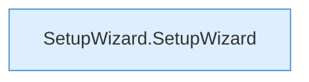

[[00 Start]] › [[Dashboard-UI]] › [[UI-Workflows]] › [[SetupWizard]]

# SetupWizard



```knoten
SetupWizard.SetupWizard
  Der [[Glossar#Assistent|Assistent]] kümmert sich um den Assistenten. Im [[Glossar#Quelltext|Quelltext]] heißt das `SetupWizard`.
```

> [!knoten]- Was die Blöcke tun
> - **SetupWizard.SetupWizard**: Der [[Glossar#Assistent|Assistent]] kümmert sich um den Assistenten. Im [[Glossar#Quelltext|Quelltext]] heißt das `SetupWizard`.

- Der [[Glossar#Assistent|Assistent]] in der [[Glossar#Bedienseite|Bedienseite]], der durch die [[Glossar#Einrichtung|Einrichtung]] führt.
