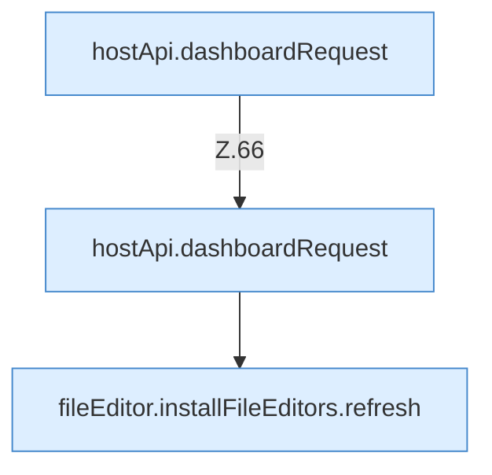

[[00 Start]] › [[Dashboard-UI]] › [[UI-Workflows]] › [[SetupWorkflow]] › [[SetupWorkflow.SetupWorkflow]] › [[SetupWorkflow.SetupWorkflow.Teil2]]

# SetupWorkflow.SetupWorkflow.Teil2



```knoten
hostApi.dashboardRequest
  Schickt von der [[Glossar#Bedienseite|Bedienseite]] eine Anfrage an das [[Glossar#Plugin|Plugin]]. `dashboardRequest` in `hostApi.ts`.
fileEditor.installFileEditors.refresh
  Die [[Glossar#Bedienseite|Bedienseite]] lädt neu das. Lädt neu `refresh`. Ruft `editorFor`.
```

> [!knoten]- Was die Blöcke tun
> - **hostApi.dashboardRequest**: Schickt von der [[Glossar#Bedienseite|Bedienseite]] eine Anfrage an das [[Glossar#Plugin|Plugin]]. `dashboardRequest` in `hostApi.ts`.
> - **fileEditor.installFileEditors.refresh**: Die [[Glossar#Bedienseite|Bedienseite]] lädt neu das. Lädt neu `refresh`. Ruft `editorFor`.

- Ein weiterer Abschnitt derselben Übersicht.
- Fortsetzung von `SetupWorkflow.SetupWorkflow`.
