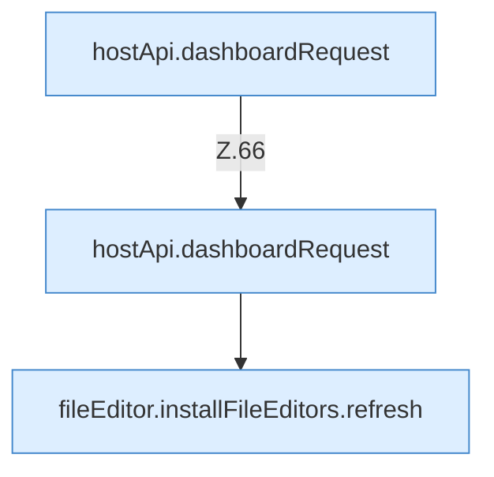

[[00 Start]] › [[Dashboard-UI]] › [[UI-Workflows]] › [[SetupWorkflow]] › [[SetupWorkflow.SetupWorkflow]] › [[SetupWorkflow.SetupWorkflow.Teil2]]

# SetupWorkflow.SetupWorkflow.Teil2



```knoten
hostApi.dashboardRequest
  `dashboardRequest` in `hostApi.ts`.
fileEditor.installFileEditors.refresh
  Lädt neu `refresh`. Ruft `editorFor`.
```

- Fortsetzung von `SetupWorkflow.SetupWorkflow`, Quellreihenfolge.
