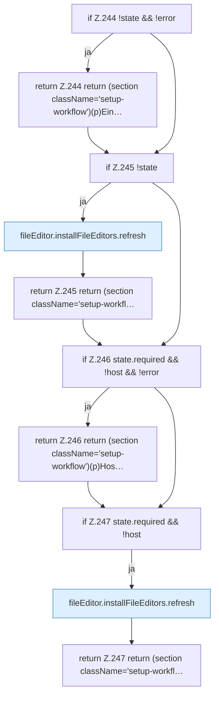

[[00 Start]] › [[Dashboard-UI]] › [[UI-Workflows]] › [[SetupWorkflow]] › [[SetupWorkflow.SetupWorkflow]] › [[SetupWorkflow.SetupWorkflow.Teil3]]

# SetupWorkflow.SetupWorkflow.Teil3



```knoten
if Z.244 !state && !error
  Zeile 244: prüft `!state && !error`.
return Z.244 return (section className='setup-workflow')(p)Ein…
  Zeile 244: Rückgabe `return (section className='setup-workflow')(p)Ein…`.
if Z.245 !state
  Zeile 245: prüft `!state`.
fileEditor.installFileEditors.refresh
  Lädt neu `refresh`. Ruft `editorFor`.
return Z.245 return (section className='setup-workfl…
  Zeile 245: Rückgabe `return (section className='setup-workfl…`.
if Z.246 state.required && !host && !error
  Zeile 246: prüft `state.required && !host && !error`.
return Z.246 return (section className='setup-workflow')(p)Hos…
  Zeile 246: Rückgabe `return (section className='setup-workflow')(p)Hos…`.
if Z.247 state.required && !host
  Zeile 247: prüft `state.required && !host`.
return Z.247 return (section className='setup-workfl…
  Zeile 247: Rückgabe `return (section className='setup-workfl…`.
```

- Fortsetzung von `SetupWorkflow.SetupWorkflow`, Quellreihenfolge.
