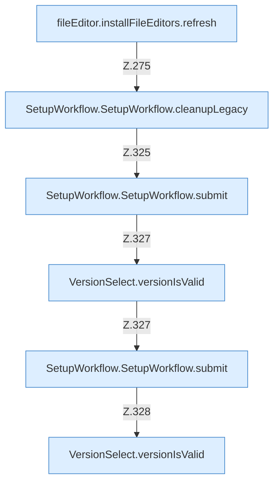

[[00 Start]] › [[Dashboard-UI]] › [[UI-Workflows]] › [[SetupWorkflow]] › [[SetupWorkflow.SetupWorkflow]] › [[SetupWorkflow.SetupWorkflow.Teil4.Calls258]]

# SetupWorkflow.SetupWorkflow.Teil4.Calls258



```knoten
fileEditor.installFileEditors.refresh
  Lädt neu `refresh`. Ruft `editorFor`.
SetupWorkflow.SetupWorkflow.cleanupLegacy
  Räumt auf `cleanupLegacy`. Ruft `dashboardRequest`, `jsonBody`, `refresh`.
SetupWorkflow.SetupWorkflow.submit
  Gibt ab `submit`. Ruft `versionIsValid`, `dashboardRequest`, `jsonBody`.
VersionSelect.versionIsValid
  `versionIsValid` in `VersionSelect.tsx`.
```

- Fortsetzung von `SetupWorkflow.SetupWorkflow.Teil4`, Quellreihenfolge.
