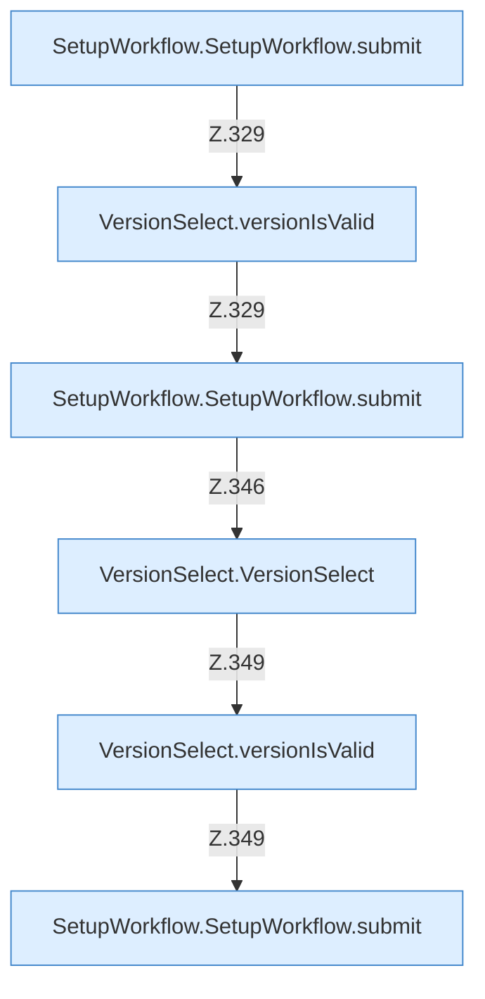

[[00 Start]] › [[Dashboard-UI]] › [[UI-Workflows]] › [[SetupWorkflow]] › [[SetupWorkflow.SetupWorkflow]] › [[SetupWorkflow.SetupWorkflow.Teil4.Calls328]]

# SetupWorkflow.SetupWorkflow.Teil4.Calls328



```knoten
SetupWorkflow.SetupWorkflow.submit
  Die [[Glossar#Bedienseite|Bedienseite]] macht hier einen einzelnen Schritt. Eine Ebene tiefer steht er genauer. Gibt ab `submit`. Ruft `versionIsValid`, `dashboardRequest`, `jsonBody`.
VersionSelect.versionIsValid
  Die [[Glossar#Bedienseite|Bedienseite]] prüft hier einen Schritt. Eine Ebene tiefer steht er genauer. `versionIsValid` in `VersionSelect.tsx`.
VersionSelect.VersionSelect
  Die [[Glossar#Bedienseite|Bedienseite]] wählt das. `VersionSelect` in `VersionSelect.tsx`.
```

> [!knoten]- Was die Blöcke tun
> - **SetupWorkflow.SetupWorkflow.submit**: Die [[Glossar#Bedienseite|Bedienseite]] macht hier einen einzelnen Schritt. Eine Ebene tiefer steht er genauer. Gibt ab `submit`. Ruft `versionIsValid`, `dashboardRequest`, `jsonBody`.
> - **VersionSelect.versionIsValid**: Die [[Glossar#Bedienseite|Bedienseite]] prüft hier einen Schritt. Eine Ebene tiefer steht er genauer. `versionIsValid` in `VersionSelect.tsx`.
> - **VersionSelect.VersionSelect**: Die [[Glossar#Bedienseite|Bedienseite]] wählt das. `VersionSelect` in `VersionSelect.tsx`.

- Weitere [[Glossar#Funktion|Funktionen]], die ab [[Glossar#Zeile|Zeile]] 328 aufgerufen werden.
- Fortsetzung von `SetupWorkflow.SetupWorkflow.Teil4`.
