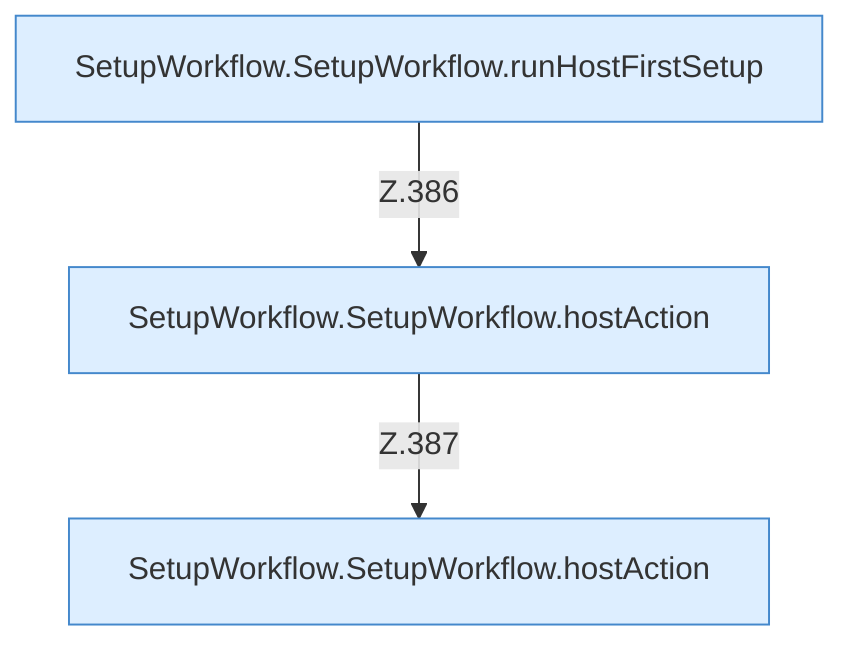

[[00 Start]] › [[Dashboard-UI]] › [[UI-Workflows]] › [[SetupWorkflow]] › [[SetupWorkflow.SetupWorkflow]] › [[SetupWorkflow.SetupWorkflow.Teil4.Calls372]]

# SetupWorkflow.SetupWorkflow.Teil4.Calls372



```knoten
SetupWorkflow.SetupWorkflow.runHostFirstSetup
  Führt aus `runHostFirstSetup`. Ruft `dashboardRequest`, `jsonBody`.
SetupWorkflow.SetupWorkflow.hostAction
  Betrifft den Host `hostAction`. Ruft `dashboardRequest`, `jsonBody`.
```

- Fortsetzung von `SetupWorkflow.SetupWorkflow.Teil4`, Quellreihenfolge.
